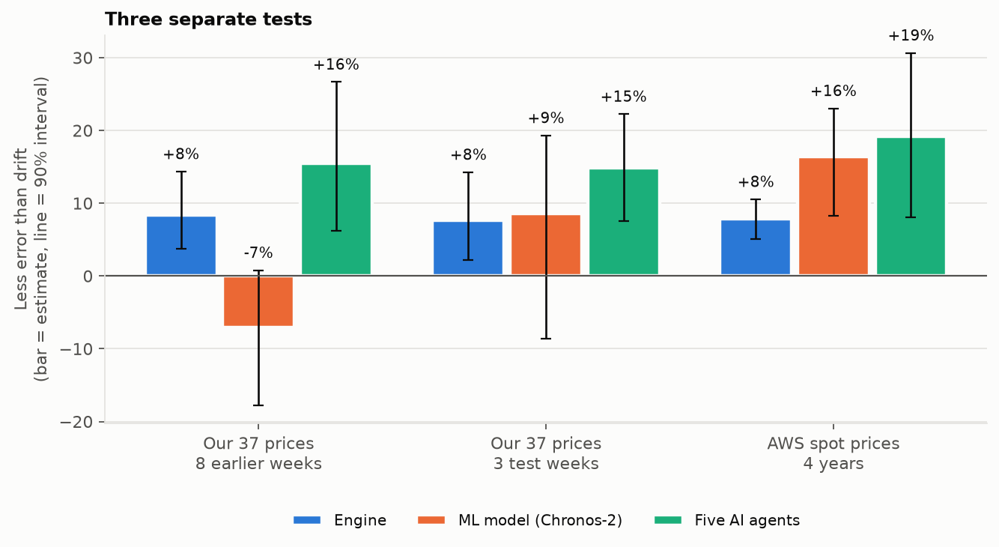
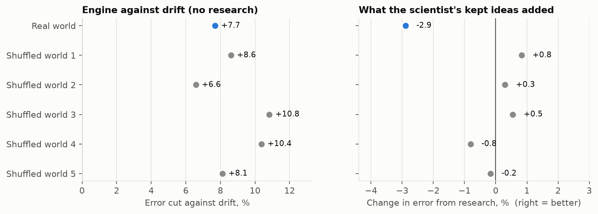

# Findings

**Direction A: self-improving GPU price forecasts.** Forecast origin 6 November 2026, horizons 1, 3 and 7 days, 37 posted rental prices.

## Summary

- **The forecast we hand in is the average of five AI agents.** Each agent reads one price's list of offers and forecasts it directly. In three separate tests the crowd cut error by 15% to 19% against drift.
- **A plain calculation that looks inside the price list is the steady base.** Our "engine" cut error by about 8% against drift in all three tests, including 206 weeks of AWS spot prices.
- **Three ways of making the system improve itself did not work.** An AI scientist tuning the engine made it slightly worse on unseen weeks. A small model trained with reinforcement learning found one change that is not clearly better. Letting the agents read each other's answers did not help.
- **What did work was different agents with different jobs, averaged.** On our own prices the crowd beat the engine by 8% on the same forecasts (likely 3% to 14%).
- **A ready-made ML model is unreliable on these prices.** It looked good in the three test weeks, failed in the eight weeks before, and works well on AWS prices.
- **Most movement in a published median is not providers changing prices.** For provider list prices, 66% comes from offers joining or leaving the list, 25% from one or two offers that reprice almost daily, and 9% from everyone else.

## The question

Each scored price is the daily median of one site's list of offers for one GPU. Can a forecast that knows what is on the list beat one that only knows how the median moved? And which kind of AI help makes it better on data it has not seen?

## What we built

- **Engine.** Drift, the reference forecast, replays how the median itself moved in the past. The engine replays what each offer did over past pairs of days (repriced, stayed, left, joined), applies that to today's list and takes the median again. It is a classic method (historical simulation) with nothing trained. It knows which offer is in the middle and how far its neighbours let the middle move.
- **AI scientist.** An OpenAI model (`gpt-6.1-sol`) proposes one hypothesis at a time as a change to the engine's 15 settings. A fixed gate keeps an idea only if it helps on past data and passes a hidden check.
- **Five AI agents.** The same model, used as five forecasters with different jobs: read the list, watch the frequent repricers, keep to base rates, weigh the reference forecasts, look for jumps that may reverse. Each sees the price's last 21 days and today's list around the middle, and returns low, middle and high for 1, 3 and 7 days. The crowd forecast is the average of the five.
- **ML model.** Chronos-2, a pretrained time-series model, used as it comes on a Modal GPU.
- **RL.** A small open model (Qwen3-8B on Tinker) trained for 1,984 tries to propose engine changes.

## How it was tested

- **A blind test fixed in advance.** [PROTOCOL.md](PROTOCOL.md) was committed (`354fc20`) before the run. The AI scientist lived through three weeks one at a time (forecast days 16 Oct to 5 Nov), each step in its own Modal container that held only data up to that day. Five shuffled copies of the data, in which the order of price changes is scrambled, ran alongside.
- **More periods afterwards.** One three-week window is thin, so we added the eight weeks before it (21 Aug to 15 Oct) and four years of AWS spot prices (19 machine types, 206 weeks, 35,952 forecasts). On AWS the published figure is the median across zones, so zones play the part of providers.
- **Scoring.** Pinball loss exactly as `starter/scorer.py` computes it; `tests/parity.py` confirms identical numbers. Ranges are 90% intervals from resampling prices and days.
- **What was and was not blind.** The three test weeks were blind for the engine and the AI scientist. The ML model and the agents were added after those weeks had been looked at. Neither model had seen any of our prices, and the agents' instructions were written once and not changed.

## Results

### 1. Three separate tests

Percent less error than drift, with the likely range:

| Forecaster | Our prices, 8 earlier weeks | Our prices, 3 test weeks | AWS, 4 years |
|---|---|---|---|
| Engine | +8.4% (+4% to +14%) | +7.7% (+2% to +14%) | +7.9% (+5% to +11%) |
| ML model | −7.1% (−18% to +1%) | +8.6% (−9% to +19%) | +16.4% (+8% to +23%) |
| Five AI agents | +15.5% (+6% to +27%) | +14.9% (+8% to +22%) | +19.2% (+8% to +31%) |

The engine is scored on every forecast day (2,573, 1,196 and 35,952 forecasts). The ML model on AWS is scored on Fridays (8,221). The agents are scored on samples: 7 days in each block of our prices (481 and 429 forecasts) and 12 days of AWS (501).

### 2. The agents against the engine

On the same forecasts:

| Test | Agents against the engine |
|---|---|
| Our prices, 8 earlier weeks | +5.6% (−2% to +11%) |
| Our prices, 3 test weeks | +10.4% (+3% to +19%) |
| Our prices, all 14 days | +8.3% (+3% to +14%) |
| AWS, 12 days | −4.4% (−31% to +17%) |

- **On our prices the agents were ahead in all 7 weeks where they ran.** On AWS they beat drift on all 12 days and were ahead of the engine on 8.
- **Every one of the five agents beat the engine** on the test days. The best was the one looking for jumps that may reverse (+18.8% against drift), then the list reader (+15.6%).
- **Seeing each other's answers did not help.** A second round, where each agent read the other four and could revise, scored 1.3% worse (−5% to +3%).
- **Their ranges are a little narrow.** The truth landed inside 69% of the time; the target is 80%.

### 3. The engine

On the three blind weeks (1,196 forecasts) the engine cut error by 7.7% against drift. The gain is at longer horizons: +2.4% at 1 day (−4% to +9%), +7.6% at 3 days (+1% to +16%), +20.7% at 7 days (+11% to +43%, 72 forecasts).

In the five shuffled worlds the engine beat drift by 6.6% to 10.8%, the same as in the real world. Its edge comes from knowing the list, not from any pattern in timing. One weak spot: on the few of our prices that go back to January, mostly four large cloud spot lists, it is no better than drift (−1.8%, −6% to +3%).

### 4. What the system learned across iterations

| Step | What changed | Result on unseen data |
|---|---|---|
| 0 | Drift | reference |
| 1 | Engine: replay each offer, take the median again | 8% less error than drift |
| 2 | Switch a price to drift when the engine had done worse on it | lowered skill in rehearsal and in all 3 test weeks; dropped |
| 3 | AI scientist: 32 ideas, 7 kept (wider ranges, recent weeks weighted more, carry the trend of daily repricers) | 2.9% worse than no research (−8% to 0%) |
| 4 | The same scientist in 5 shuffled worlds | −0.8% to +0.8%: nothing |
| 5 | RL-trained model: use 30 days of history, not 60 | +1.3% (−3% to +6%): not established |
| 6 | ML model averaged with the engine | +4.9% in the test weeks, −4.1% in the 8 weeks before: does not hold |
| 7 | Five agents forecasting directly, averaged | 8% better than the engine on our prices |
| 8 | Agents reading each other's answers | 1.3% worse than working alone |

- **Tuning on ten weeks of data overfits.** The scientist's ideas passed a gate and a hidden check and still did not hold. With hindsight, the best four setting changes would have reached 18%, and they point the opposite way from the past: earlier misses were upward, later ones downward.
- **The ideas the gate rejected were also informative.** Following other sites' prices for the same GPU cut skill from +0.235 to +0.190. Replacing the engine's middle with the last value cut it from +0.212 to +0.194.
- **The useful step was a different kind of forecaster,** one that reads the same list but reasons about it case by case.

### 5. The ML model

Week by week on our prices it swings from −21% to +19% against drift and is above zero in 5 of 11 weeks; two of its three best weeks are test weeks. On AWS prices, with years of history per series, it beats the engine by 10.9% (+1% to +19%). We do not use it in the forecast.

### 6. What moves a published median

- **A typical provider list** has 12 offers from 10 providers, of which one reprices often. The typical offer never changed price in the sample, yet the median moved on about a third of days.
- **A median can jump on an announcement, before the price takes effect.** On 6 Nov one tracking site began recording Lambda's announced prices (B200 $6.69 to $7.69, H100 $3.99 to $4.59), which a news report dates to 16 Nov. Its B200 median rose from $6.89 to $7.89 that day. The other two sites still showed the old prices, and their medians did not move, because Lambda sits above the middle of their lists.
- **The same thing reversed once before.** Crusoe's page lists new prices "starting Dec 1, 2026". The tracking sites recorded those higher prices from 16 to 21 Oct, then went back.

Sources: GPUJournal, "Lambda announces GPU price rises of about 15% — B200, H100 and A100 80GB, from Nov 16", 6 Nov 2026, https://gpujournal.ai/story/lambda-announced-rises-nov-16. Crusoe, "Crusoe Cloud pricing", https://www.crusoe.ai/cloud/pricing, as stored on or before 6 Nov 2026 (read through Exa Snapshot). Tracking-site readings are from the data pack.

### 7. Rolling forward, and the 2 to 3 year view

Rolled forward a day at a time, the engine's ranges hold the truth 77% of the time at 1 day, 52% at 7 days and about 40% from two weeks to 90 days. It can be trusted for days, not months.

**Rentals (AWS spot, USD per GPU-hour, median across zones).** Details in [longview/LONGVIEW.md](longview/LONGVIEW.md).

| | Now (31 Oct 2026) | +1 year | +2 years | +3 years |
|---|---|---|---|---|
| H100 | 3.86 | 2.69 (1.05–8.25) | 2.56 (0.97–7.15) | 2.54 (0.94–6.89) |
| A100 | 2.12 | 1.27 (0.78–3.18) | 1.25 (0.75–2.80) | 1.24 (0.74–2.70) |

- **The central path assumes the 2026 rise fades.** H100 spot rose from $2.13 to $3.86 between July and October 2026. If it does not fade, the middle is about $3.6 for the H100 and $2.0 for the A100.
- **Older chips did not fall faster when a successor arrived.** The A100 fell 20% a year before the H100 arrived and was flat afterwards.
- **Tested horizon:** about six months. One year rests on 2 to 4 independent windows; three years is untested.

**Resale.** **Resale (USD per bare GPU module; a different kind of price again).** Public evidence is thin. American Compute puts the middle of used resale prices at $10,000 to $14,000 for an H100 and $4,700 to $5,400 for an A100 80GB over the year to August 2026 (American Compute, GPU Prices, October 2026, https://www.amcompute.com/gpu-prices). We take the midpoints, $12,000 and $5,050, as today's price. Five other dated figures are in [longview/RESALE.md](longview/RESALE.md).

We value a used GPU as the rent it can still earn: rent × utilisation, less running cost, over its remaining earning life, discounted. The resale outlook is today's price times how that value changes over time. Rent and resale are never joined into one series.

| Middle (10% to 90%) | +1 year | +2 years | +3 years |
|---|---|---|---|
| H100, share of today's value | 70% (8–253%) | 45% (4–169%) | 19% (0–94%) |
| H100, from $12,000 | $8,400 (900–30,300) | $5,400 (500–20,200) | $2,300 (0–11,300) |
| A100, share of today's value | 57% (17–182%) | 26% (0–96%) | 0% (0–36%) |
| A100, from $5,050 | $2,900 (800–9,200) | $1,300 (0–4,900) | $0 (0–1,800) |

- **The ranges are very wide, and the tops are probably out of reach.** They assume rents near the top of the rental outlook.
- **Zero means "stopped earning".** The model gives no scrap value.
- **What drives it:** the rent path first, the remaining earning life second.
- **One untested step:** the share comes from what an installed GPU earns, and we assume a bare module's price moves in step.

## What someone pricing a lease or a loan could use

- **Read a published median with its list.** A move is far more likely to be an offer entering or leaving the sample, or one dynamic pricer, than a change in what providers charge.
- **Check which site, and when.** The same announced price change reached one site ten days early and the others not at all.
- **Do not extrapolate a short-run forecaster.** Ranges that are right for a week are too narrow by a month.
- **Be wary of tuned models on short histories.** Careful tuning, a hidden check and a strong model still produced changes that did not survive.

## The forecast we submit

`submission/forecast_2026-11-06.csv`: the five agents' average, 111 forecasts. `submission/alt_engine_2026-11-06.csv` is the engine alone, which has the longer and cleaner test record. Other variants we tested are in `submission/other/`.

## Limits

- **The agents were tested on samples:** 14 days of our prices and 12 days of AWS. On our prices only 61 of the 910 forecasts are 7 days ahead.
- **The agents and the ML model were added after the blind test.** Their results come from the same weeks, which had been looked at by then.
- **The agents' model may have met the AWS years in training,** since its knowledge runs to April 2026. Only one of the twelve AWS days is later.
- **AWS prices are a different kind of price.** AWS sets them itself and they move in small steps.
- **The 37 prices were chosen with hindsight to 6 Nov** by the starter kit's rule, and 33 of them have under 90 days of history.
- **Agent answers are not deterministic.** A second run gives slightly different numbers.
- **Posted prices, not transacted prices.**

## Deviations from the protocol

Listed in [PROTOCOL.md](PROTOCOL.md). The main ones: the submission is the agent crowd, which was not in the protocol; the ML model, the agents and the extra test periods were added after the blind test; the RL trial was lengthened.

## Reproduce

`bash reproduce.sh` rebuilds both forecast files in about 15 seconds with no AI calls. The main file is rebuilt from the agents' recorded answers (`runs/agents/final_answers.json`). `bash reproduce.sh --with-backtest` replays the AI scientist's blind test and reproduces its results table exactly.
