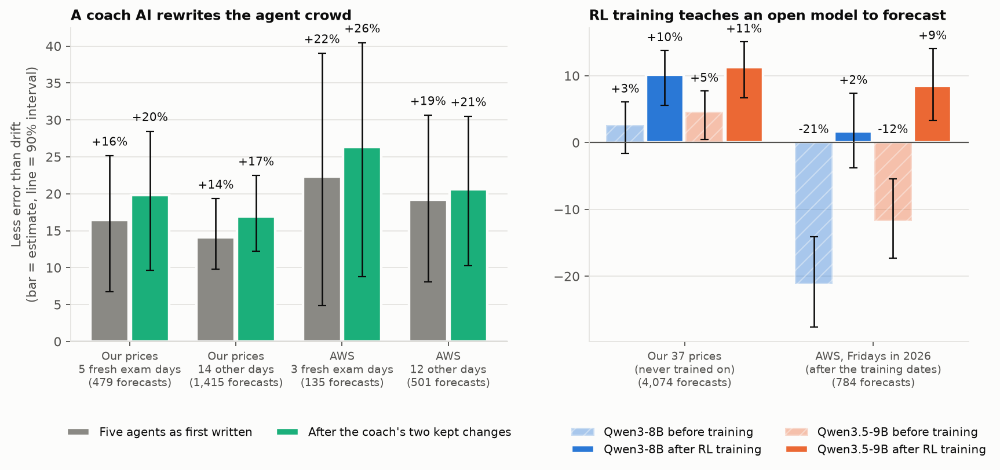
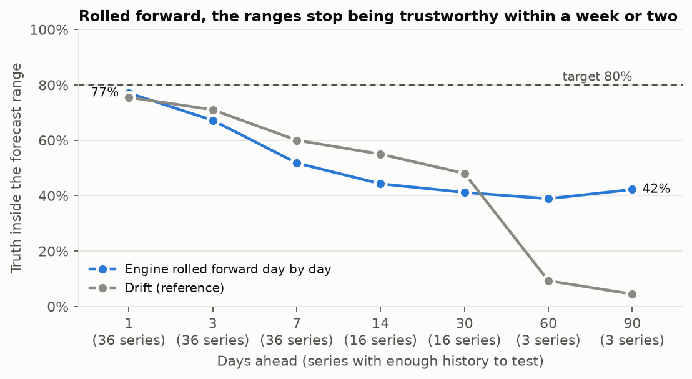

# Findings

**Direction A: self-improving GPU price forecasts.** Forecast origin 6 November 2026, horizons 1, 3 and 7 days, 37 posted rental prices.

## Summary

- **The forecast we hand in is the average of five AI agents, after two changes that a coach AI proposed and tests kept.** Each agent reads one price's list of offers and forecasts it directly. In three separate tests the crowd as first written cut error by 15% to 19% against drift. The coach's changes cut a further 3% to 4% on days the coach never saw.
- **A plain calculation that looks inside the price list is the steady base.** Our "engine" cut error by about 8% against drift in all three tests, including 206 weeks of AWS spot prices.
- **Two ways of making the system improve itself held up on fresh days.** A coach AI that rewrites the agent crowd (10 changes proposed, 2 kept). And reinforcement learning that teaches a small open model to forecast: it practised on AWS prices only, and on our prices went from about 3% less error than drift to between 5% and 11% less, depending on the run (eight runs, on Tinker and on Modal GPUs).
- **Three other ways did not.** An AI scientist tuning the engine made it slightly worse on unseen weeks. A small model trained with reinforcement learning to propose engine settings found one change that is not clearly better. Letting the agents read each other's answers did not help.
- **Different agents with different jobs, averaged, beat the engine.** On our own prices the crowd as first written was 8% ahead on the same forecasts (likely 3% to 14%), and the improved crowd 10% ahead (5% to 14%).
- **A ready-made ML model is unreliable on these prices.** It looked good in the three test weeks, failed in the eight weeks before, and works well on AWS prices.
- **Most movement in a published median is not providers changing prices.** For provider list prices, 66% comes from offers joining or leaving the list, 25% from one or two offers that reprice almost daily, and 9% from everyone else.

## The question

Each scored price is the daily median of one site's list of offers for one GPU. Can a forecast that knows what is on the list beat one that only knows how the median moved? And which kind of AI help makes it better on data it has not seen?

## What we built

- **Engine.** Drift, the reference forecast, replays how the median itself moved in the past. The engine replays what each offer did over past pairs of days (repriced, stayed, left, joined), applies that to today's list and takes the median again. It is a classic method (historical simulation) with nothing trained. It knows which offer is in the middle and how far its neighbours let the middle move.
- **AI scientist.** An OpenAI model (`gpt-6.1-sol`) proposes one hypothesis at a time as a change to the engine's 15 settings. A fixed gate keeps an idea only if it helps on past data and passes a hidden check.
- **Five AI agents.** The same model, used as five forecasters with different jobs: read the list, watch the frequent repricers, keep to base rates, weigh the reference forecasts, look for jumps that may reverse. Each sees the price's last 21 days and today's list around the middle, and returns low, middle and high for 1, 3 and 7 days. The crowd forecast is the average of the five.
- **Coach.** The same OpenAI model, used to improve the crowd. It sees the crowd's scores and worst misses on practice days and proposes one change at a time: rewrite an agent's instructions, add an agent, drop one, or stretch the ranges. A change is kept only if the crowd improves on the practice days and passes a hidden check on other days.
- **ML model.** Chronos-2, a pretrained time-series model, used as it comes on a Modal GPU.
- **RL, two uses.** First, a small open model (Qwen3-8B on Tinker) trained for 1,984 tries to propose engine changes. Second, Qwen3-8B and Qwen3.5-9B each trained for 7,680 tries to forecast directly: the model reads the same facts as the agents and answers with a low, middle and high percent move, and its reward is how much less error it made than drift. The same training also runs on Modal GPUs with our own sampling and update code (`rl/modal_forecaster.py`), many runs at once.

## How it was tested

- **A blind test fixed in advance.** [PROTOCOL.md](PROTOCOL.md) was committed (`354fc20`) before the run. The AI scientist lived through three weeks one at a time (forecast days 16 Oct to 5 Nov), each step in its own Modal container that held only data up to that day. Five shuffled copies of the data, in which the order of price changes is scrambled, ran alongside.
- **More periods afterwards.** One three-week window is thin, so we added the eight weeks before it (21 Aug to 15 Oct) and four years of AWS spot prices (19 machine types, 206 weeks, 35,952 forecasts). On AWS the published figure is the median across zones, so zones play the part of providers.
- **Scoring.** Pinball loss exactly as `starter/scorer.py` computes it; `tests/parity.py` confirms identical numbers. Ranges are 90% intervals from resampling prices and days.
- **Fresh days for the two later loops.** The coach practised on 6 days and was checked on 5 others (AWS in 2024–25 and our prices before 16 Oct). Its exam was 5 days of our prices in the test weeks that no agent had answered before, and 3 AWS days from July to October 2026, after the model's knowledge ends. A second check used the 14 days and 12 AWS days that the first crowd had answered before the coach existed. The open model practised on AWS prices up to June 2025 and was tested on our prices (43 days) and on AWS Fridays in 2026.
- **What was and was not blind.** The three test weeks were blind for the engine and the AI scientist. The ML model, the agents, the coach and the RL forecaster were added after those weeks had been looked at. None of the models had seen any of our prices before its test. The first crowd's instructions were written once by hand; after that only the coach changed them.

## Results

### 1. Three separate tests

Percent less error than drift, with the likely range:

| Forecaster | Our prices, 8 earlier weeks | Our prices, 3 test weeks | AWS, 4 years |
|---|---|---|---|
| Engine | +8.4% (+4% to +14%) | +7.7% (+2% to +14%) | +7.9% (+5% to +11%) |
| ML model | −7.1% (−18% to +1%) | +8.6% (−9% to +19%) | +16.4% (+8% to +23%) |
| Five AI agents | +15.5% (+6% to +27%) | +14.9% (+8% to +22%) | +19.2% (+8% to +31%) |

The engine is scored on every forecast day (2,573, 1,196 and 35,952 forecasts). The ML model on AWS is scored on Fridays (8,221). The agents are scored on samples: 7 days in each block of our prices (481 and 429 forecasts) and 12 days of AWS (501).

### 2. The agents against the engine

On the same forecasts:

| Test | Agents against the engine |
|---|---|
| Our prices, 8 earlier weeks | +5.6% (−2% to +11%) |
| Our prices, 3 test weeks | +10.4% (+3% to +19%) |
| Our prices, all 14 days | +8.3% (+3% to +14%) |
| AWS, 12 days | −4.4% (−31% to +17%) |

- **On our prices the agents were ahead in all 7 weeks where they ran.** On AWS they beat drift on all 12 days and were ahead of the engine on 8.
- **Every one of the five agents beat the engine** on the test days. The best was the one looking for jumps that may reverse (+18.8% against drift), then the list reader (+15.6%).
- **Seeing each other's answers did not help.** A second round, where each agent read the other four and could revise, scored 1.3% worse (−5% to +3%).
- **Their ranges are a little narrow.** The truth landed inside 69% of the time; the target is 80%. The coach's first kept change addresses this (section 3).

### 3. Two improvement loops that held up

**A coach AI rewrites the agent crowd.** Percent less error than drift, with the likely range:

| Test | Crowd as first written | After the coach | Improved against first |
|---|---|---|---|
| Our prices, 5 fresh exam days (479 forecasts) | +16.4% (+7% to +25%) | +19.8% (+10% to +29%) | +4.0% (+0.5% to +7.6%) |
| Our prices, 14 other days (1,415) | +14.1% (+10% to +19%) | +17.0% (+12% to +23%) | +3.4% (+1.6% to +5.1%) |
| AWS, 3 fresh exam days (135) | +22.3% (+5% to +39%) | +26.4% (+9% to +41%) | +5.2% (−3% to +10%) |
| AWS, 12 other days (501) | +19.2% (+8% to +31%) | +20.6% (+10% to +31%) | +1.8% (−4% to +6%) |

- **Ten changes proposed, two kept.** Kept: stretch the crowd's ranges by 1.25 at 3 days and 1.65 at 7 days; and rewrite the "base-rate keeper" so that it measures how often and how far this price has moved before and trusts a recent trend less at longer horizons. Seven changes did not improve the practice days. One, dropping an agent, improved the practice days (+17.5% to +17.9%) and failed the hidden check.
- **Most of the gain is the wider ranges.** On the 14 days they account for +2.4% (+0.7% to +4.2%) and the rewritten agent for +1.0% (+0.1% to +2.1%). On the exam days the rewritten agent adds +0.4% (−2% to +3%).
- **The gain is at 7 days.** On the 14 days: +5.1% at 7 days (+2.5% to +7.9%), +1.9% at 3 days, +0.3% at 1 day.
- **The ranges are closer to target.** On the exam days the truth landed inside 78% of the time, up from 71%; at 7 days, 76%, up from 61%. The target is 80%.
- **Against the engine, same forecasts:** +10.8% on the exam days (+2% to +18%) and +9.9% on the 14 days (+5% to +14%).
- **How these are counted.** This table counts every forecast whose outcome is known by 6 Nov. Sections 1 and 2 count only forecasts that land inside the same test week (910 of the 1,415), which leaves out most 7-day forecasts. On those 910 the improvement is +2.6% (+0.3% to +4.8%).

**RL teaches an open model to forecast.** Percent less error than drift, before and after training:

| Model | Our 37 prices (4,074 forecasts, 43 days) | AWS Fridays in 2026 (784 forecasts, 18 days) |
|---|---|---|
| Qwen3-8B | +2.6% → **+10.1%** (+6% to +14%) | −21.2% → **+1.7%** (−4% to +7%) |
| Qwen3.5-9B | +4.6% → **+11.3%** (+7% to +15%) | −11.8% → **+8.6%** (+3% to +14%) |
| Engine, same forecasts | +10.1% (+6% to +15%) | +1.3% (−8% to +11%) |

- **Training helped on prices the model never practised on.** After against before on our prices: +7.7% for Qwen3-8B (+4% to +11%) and +7.1% for Qwen3.5-9B (+3% to +10%). It practised on AWS prices only, so the skill carried over to a different kind of price.
- **It learned how wide to make a range.** The truth landed inside 54% to 60% of the time before training and 79% after.
- **The newer model is better.** Trained Qwen3.5-9B against trained Qwen3-8B: +1.3% on our prices (−1% to +4%) and +7.0% on AWS (+2% to +11%). It cost about $16 to train, against $5.
- **Where it stands.** In these two runs, level with the engine on our prices (+1.3%, −7% to +7%) and behind the GPT crowd: on the 14 days both answered, +12.7% against the crowd's +14.1% as first written and +17.0% after the coach. The repeat runs below put it level with the engine at best.
- **As a sixth agent it adds nothing clear.** Added to the improved crowd on the exam days: +1.4% for Qwen3.5-9B (−1% to +4%) and +0.3% for Qwen3-8B. It is not in the forecast.

**The same training on Modal, ten more runs.** One run per model is thin, so we wrote our own sampling and update code, ran it on rented H100 GPUs, and repeated the Qwen3-8B training with four learning rates and two random seeds each, all at once. The learning rate was chosen on a separate watch set of later AWS practice prices, before any test result existed.

| Qwen3-8B run | Our 37 prices | AWS Fridays in 2026 |
|---|---|---|
| Untrained | +2.7% | −21.3% |
| Tinker, one run | +10.1% (+6% to +14%) | +1.7% (−4% to +7%) |
| Modal, same settings and practice prices as the Tinker run | +10.1% (+6% to +14%) | −0.9% (−7% to +5%) |
| Modal, same settings, second random seed | +6.5% (+1% to +11%) | −0.7% (−7% to +6%) |
| Modal, rate 1e-4 (chosen on the watch set), two seeds | +7.0%, +5.4% | +3.5%, +6.4% |
| Modal, rate 1e-4, three times the practice, two seeds | +7.1%, +8.1% | +4.3%, +8.5% |
| Modal, rate 2.5e-4, two seeds | +7.8%, +0.1% | −6.6%, −16.6% |
| Modal, rate 6e-4, two seeds | +3.0%, +3.0% | −20.9%, −21.0% |

- **The Tinker result reproduces.** Different code and hardware, same settings and practice prices: +10.1% on our prices both times. The untrained model matches too (+2.7% against +2.6%).
- **One run had flattered it.** A second random seed at the same settings gave +6.5%. The four 60-round runs at the two workable learning rates gave +5.4% to +10.1%, on average +7.3%. Every one beats the untrained model; the gain over it is 3 to 8 points.
- **The learning rate decides whether training works at all.** At the highest rate both runs collapsed onto one repeated answer within about 15 rounds and stopped learning. At the next one down, one run ended worse than untrained.
- **Three times the practice helped a little.** 180 rounds gave +7.1% and +8.1%, against +7.0% and +5.4% at 60 rounds: clearly better for one seed only (+2.9%, +0.4% to +5.7%). The watch score was flat after about round 60.
- **The watch set picked the rate that is better on AWS, not on our prices.** The watch set is AWS prices. Rate 1e-4 did better than 4e-5 on AWS (+3.5% and +6.4% against −0.9% and −0.7%) and worse on our prices.
- **Averaging runs does not beat the best single run.** The two chosen-rate runs averaged give +6.7% on our prices; all four give +8.4%.
- **Cost and time.** A 60-round run with its test cost $3.50 to $4.10 on a Modal H100 and took about an hour; the same on Tinker cost $6.62 with about 10 minutes of training. Eight Modal runs at once took the same hour as one.

### 4. The engine

On the three blind weeks (1,196 forecasts) the engine cut error by 7.7% against drift. The gain is at longer horizons: +2.4% at 1 day (−4% to +9%), +7.6% at 3 days (+1% to +16%), +20.7% at 7 days (+11% to +43%, 72 forecasts).

In the five shuffled worlds the engine beat drift by 6.6% to 10.8%, the same as in the real world. Its edge comes from knowing the list, not from any pattern in timing. One weak spot: on the few of our prices that go back to January, mostly four large cloud spot lists, it is no better than drift (−1.8%, −6% to +3%).

### 5. What the system learned across iterations

| Step | What changed | Result on unseen data |
|---|---|---|
| 0 | Drift | reference |
| 1 | Engine: replay each offer, take the median again | 8% less error than drift |
| 2 | Switch a price to drift when the engine had done worse on it | lowered skill in rehearsal and in all 3 test weeks; dropped |
| 3 | AI scientist: 32 ideas, 7 kept (wider ranges, recent weeks weighted more, carry the trend of daily repricers) | 2.9% worse than no research (−8% to 0%) |
| 4 | The same scientist in 5 shuffled worlds | −0.8% to +0.8%: nothing |
| 5 | RL-trained model: use 30 days of history, not 60 | +1.3% (−3% to +6%): not established |
| 6 | ML model averaged with the engine | +4.9% in the test weeks, −4.1% in the 8 weeks before: does not hold |
| 7 | Five agents forecasting directly, averaged | 8% better than the engine on our prices |
| 8 | Agents reading each other's answers | 1.3% worse than working alone |
| 9 | Coach AI: 10 changes to the crowd proposed, 2 kept (wider ranges at 3 and 7 days, one agent rewritten) | 4.0% better than the first crowd on fresh days (+0.5% to +7.6%); 3.4% on 14 other days |
| 10 | RL: an open model trained to forecast directly, on AWS prices only | from about +3% to between +5% and +11% against drift on our prices, depending on the run; level with the engine at best |
| 10b | The same RL training repeated on Modal: 4 learning rates x 2 seeds, then 3x the practice | reproduces the first run exactly with the same seed; other seeds lower; too high a rate collapses |
| 11 | The trained open model added to the crowd as a sixth agent | +1.4% (−1% to +4%): not established; left out |

- **Tuning on ten weeks of data overfits.** The scientist's ideas passed a gate and a hidden check and still did not hold. With hindsight, the best four setting changes would have reached 18%, and they point the opposite way from the past: earlier misses were upward, later ones downward.
- **The ideas the gate rejected were also informative.** Following other sites' prices for the same GPU cut skill from +0.235 to +0.190. Replacing the engine's middle with the last value cut it from +0.212 to +0.194.
- **The useful step was a different kind of forecaster,** one that reads the same list but reasons about it case by case.
- **The loops that held up had more to practise on.** The scientist tuned 15 settings against ten weeks of one history. The coach was scored on 227 price-days of two kinds of price across three years, and the RL forecaster had 7,680 tries on three years of AWS prices. This is our reading of the difference, not something we tested.
- **What the coach found was mostly a blind spot in our own testing.** The first crowd's 7-day ranges were too narrow (truth inside 53% of the time). Our earlier tables had scored few 7-day forecasts, so we had not seen it.

### 6. The ML model

Week by week on our prices it swings from −21% to +19% against drift and is above zero in 5 of 11 weeks; two of its three best weeks are test weeks. On AWS prices, with years of history per series, it beats the engine by 10.9% (+1% to +19%). We do not use it in the forecast.

### 7. What moves a published median

- **A typical provider list** has 12 offers from 10 providers, of which one reprices often. The typical offer never changed price in the sample, yet the median moved on about a third of days.
- **A median can jump on an announcement, before the price takes effect.** On 6 Nov one tracking site began recording Lambda's announced prices (B200 $6.69 to $7.69, H100 $3.99 to $4.59), which a news report dates to 16 Nov. Its B200 median rose from $6.89 to $7.89 that day. The other two sites still showed the old prices, and their medians did not move, because Lambda sits above the middle of their lists.
- **The same thing reversed once before.** Crusoe's page lists new prices "starting Dec 1, 2026". The tracking sites recorded those higher prices from 16 to 21 Oct, then went back.

Sources: GPUJournal, "Lambda announces GPU price rises of about 15% — B200, H100 and A100 80GB, from Nov 16", 6 Nov 2026, https://gpujournal.ai/story/lambda-announced-rises-nov-16. Crusoe, "Crusoe Cloud pricing", https://www.crusoe.ai/cloud/pricing, as stored on or before 6 Nov 2026 (read through Exa Snapshot). Tracking-site readings are from the data pack.

### 8. Rolling forward, and the 2 to 3 year view

Rolled forward a day at a time, the engine's ranges hold the truth 77% of the time at 1 day, 52% at 7 days and about 40% from two weeks to 90 days. It can be trusted for days, not months.

**Rentals (AWS spot, USD per GPU-hour, median across zones).** Details in [longview/LONGVIEW.md](longview/LONGVIEW.md).

| | Now (31 Oct 2026) | +1 year | +2 years | +3 years |
|---|---|---|---|---|
| H100 | 3.86 | 2.69 (1.05–8.25) | 2.56 (0.97–7.15) | 2.54 (0.94–6.89) |
| A100 | 2.12 | 1.27 (0.78–3.18) | 1.25 (0.75–2.80) | 1.24 (0.74–2.70) |

- **The central path assumes the 2026 rise fades.** H100 spot rose from $2.13 to $3.86 between July and October 2026. If it does not fade, the middle is about $3.6 for the H100 and $2.0 for the A100.
- **Older chips did not fall faster when a successor arrived.** The A100 fell 20% a year before the H100 arrived and was flat afterwards.
- **Tested horizon:** about six months. One year rests on 2 to 4 independent windows; three years is untested.

**Resale.** **Resale (USD per bare GPU module; a different kind of price again).** Public evidence is thin. American Compute puts the middle of used resale prices at $10,000 to $14,000 for an H100 and $4,700 to $5,400 for an A100 80GB over the year to August 2026 (American Compute, GPU Prices, October 2026, https://www.amcompute.com/gpu-prices). We take the midpoints, $12,000 and $5,050, as today's price. Five other dated figures are in [longview/RESALE.md](longview/RESALE.md).

We value a used GPU as the rent it can still earn: rent × utilisation, less running cost, over its remaining earning life, discounted. The resale outlook is today's price times how that value changes over time. Rent and resale are never joined into one series.

| Middle (10% to 90%) | +1 year | +2 years | +3 years |
|---|---|---|---|
| H100, share of today's value | 70% (8–253%) | 45% (4–169%) | 19% (0–94%) |
| H100, from $12,000 | $8,400 (900–30,300) | $5,400 (500–20,200) | $2,300 (0–11,300) |
| A100, share of today's value | 57% (17–182%) | 26% (0–96%) | 0% (0–36%) |
| A100, from $5,050 | $2,900 (800–9,200) | $1,300 (0–4,900) | $0 (0–1,800) |

- **The ranges are very wide, and the tops are probably out of reach.** They assume rents near the top of the rental outlook.
- **Zero means "stopped earning".** The model gives no scrap value.
- **What drives it:** the rent path first, the remaining earning life second.
- **One untested step:** the share comes from what an installed GPU earns, and we assume a bare module's price moves in step.

## What someone pricing a lease or a loan could use

- **Read a published median with its list.** A move is far more likely to be an offer entering or leaving the sample, or one dynamic pricer, than a change in what providers charge.
- **Check which site, and when.** The same announced price change reached one site ten days early and the others not at all.
- **Do not extrapolate a short-run forecaster.** Ranges that are right for a week are too narrow by a month.
- **Be wary of tuned models on short histories.** Careful tuning, a hidden check and a strong model still produced changes that did not survive.

## The forecast we submit

`submission/forecast_2026-11-06.csv`: the average of the five agents after the coach's two kept changes, 111 forecasts. Four agents keep the answers they gave for the first crowd; the rewritten agent was asked again from the same facts. Middles moved by more than 0.1% in 17 of the 111 forecasts, and the average range went from 6.2% to 10.8% of the price at 7 days. `submission/other/agents_original_2026-11-06.csv` is the crowd as first written. `submission/alt_engine_2026-11-06.csv` is the engine alone, which has the longer and cleaner test record. Other variants we tested are in `submission/other/`.

## Limits

- **The agents were tested on samples:** 19 days of our prices and 15 days of AWS.
- **The agents, the ML model, the coach and the RL forecaster were added after the blind test.** Their results come from the same weeks, which had been looked at by then. The coach and the open model saw none of their test days, but we chose which days those were.
- **RL results vary from run to run.** The same settings with a different random seed moved the result on our prices from +10.1% to +6.5%. Single-run figures for the trained models should be read with that in mind; Qwen3.5-9B on Tinker is one run.
- **The coach ran once.** A second run would propose different changes. Its gain is mostly a correction to range width, which a simpler rule could also have found.
- **The second check of the coach is not fully fresh:** we already knew how the first crowd had scored on those 14 days, though not how the improved crowd would.
- **The agents' model may have met the AWS years in training,** since its knowledge runs to April 2026. Only one of the twelve AWS days is later.
- **AWS prices are a different kind of price.** AWS sets them itself and they move in small steps.
- **The 37 prices were chosen with hindsight to 6 Nov** by the starter kit's rule, and 33 of them have under 90 days of history.
- **Agent answers are not deterministic.** A second run gives slightly different numbers.
- **Posted prices, not transacted prices.**

## Deviations from the protocol

Listed in [PROTOCOL.md](PROTOCOL.md). The main ones: the submission is the agent crowd, which was not in the protocol; the ML model, the agents and the extra test periods were added after the blind test; the RL trial was lengthened; the coach and the RL forecaster were added last, and the submission changed from the first crowd to the improved one.

## Reproduce

`bash reproduce.sh` rebuilds the forecast files in about 15 seconds with no AI calls. The main file is rebuilt from the agents' recorded answers (`runs/coach/final_answers.json`; the first crowd's are in `runs/agents/final_answers.json`). The coach's ledger of all ten changes is `runs/coach/state.json`. `bash reproduce.sh --with-backtest` replays the AI scientist's blind test and reproduces its results table exactly.
