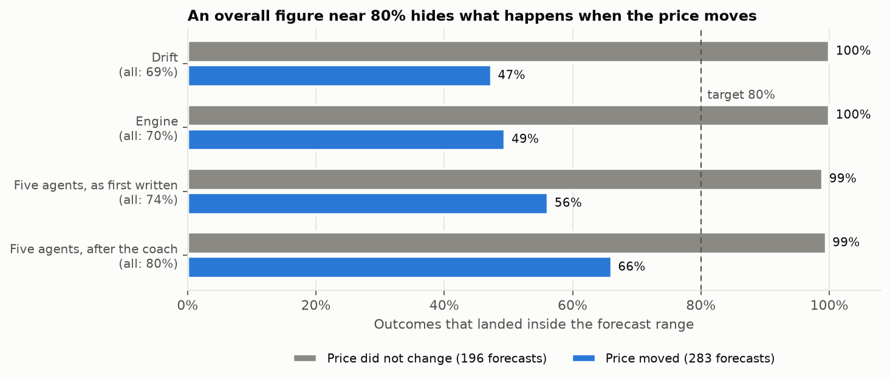
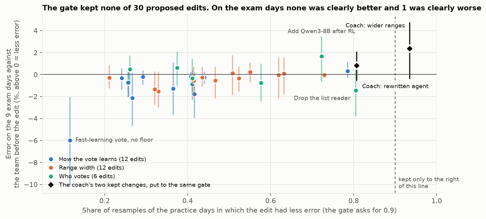

# Findings

**Direction A: self-improving GPU price forecasts.** Forecast origin 6 November 2026, horizons 1, 3 and 7 days, 37 posted rental prices.

## Summary

- **The forecast we hand in is the average of five AI agents, after two changes that a coach AI proposed and tests kept.** Each agent reads one price's list of offers and forecasts it directly. In three separate tests the crowd as first written cut error by 15% to 19% against drift. The third test, on AWS prices, mostly uses days the model may have read about; on the four AWS days after its knowledge ends the cut was 18% (likely 3% to 35%), and asked directly it could recall none of those prices. The coach's changes cut a further 3% to 4% on days the coach never saw.
- **A plain calculation that looks inside the price list is the steady base.** Our "engine" cut error by about 8% against drift in all three tests, including 206 weeks of AWS spot prices.
- **Two ways of making the system improve itself held up on fresh days.** A coach AI that proposes changes to the agent crowd (10 proposed, 2 kept; nearly all of the gain comes from one of them, wider ranges). And reinforcement learning that teaches a small open model to forecast: it practised on AWS prices only, and on our prices Qwen3-8B went from about 3% less error than drift to between 5% and 10% less, depending on the run (seven runs, on Tinker and on Modal GPUs). The newer Qwen3.5-9B went from 5% to between 9% and 11% in three runs at the lower learning rate, and showed no gain in two runs at a higher one. The two models end level.
- **Three other ways did not.** An AI scientist tuning the engine made it slightly worse on unseen weeks. A small model trained with reinforcement learning to propose engine settings found one change that is not clearly better. Letting the agents read each other's answers did not help.
- **Learning from its own past forecasts: three ways, one modest result.** We gave the crowd a memory with no AI in it (range width set from its own resolved forecasts), showed each agent its own scored record, and let each agent write itself a lesson from that record. All three found the fault the coach found, ranges too narrow at 3 and 7 days. They cut error by 1.4% to 2.1%, and in each case the likely range includes zero, so none is established. The no-AI memory also recovers 6 of the 8 points that RL training gave Qwen3-8B.
- **An AI analyst that writes its own tests found three timing patterns that held on data it never saw.** One is a weekday pattern wider than anything we had found by hand: three scored cloud spot prices move almost only on Mondays and Tuesdays. A simple rule built on it did not make the forecasts better.
- **One loop over the whole forecaster kept nothing, and it was right to.** Every test above was started by hand, so we added one loop that runs unattended: generation after generation, an AI proposes one change to how the team is put together (a vote that learns each member's weight, the range width, who votes), and the change is kept only if it has less error in 90% of resamples. It kept none of the AI's 6 proposals and none of 30 random ones. On nine later days none of those edits was clearly better and one was clearly worse. Put to the same gate, the coach's wider ranges would have been kept. The one edit that looked promising, a vote for an RL-trained open model, was then tested once on 20 days the crowd had never answered: +0.9% (−0.4% to +2.2%), not established. On those 20 days the team we handed in cut error by 14.8% against drift (+10% to +21%) (section 12).
- **With RL training inside the loop, one generation was accepted and it held up.** The same keep-or-roll-back loop, this time training Qwen3.5-9B: 8 rounds of RL practice, then a watch set decides whether the new weights are kept. Of five generations one was accepted and four were rolled back. The kept weights, tested once on our 37 prices, cut error by 4.0% against the untrained model (+0.1% to +6.8%) and their ranges held the truth 80% of the time, up from 60% (section 12).
- **Five AI agents that read the price list beat the engine.** On our own prices the crowd as first written was 8% ahead on the same forecasts (likely 3% to 14%), and the improved crowd 10% ahead (5% to 14%). We did not show that their different jobs, or the averaging, are the reason: the best single agent scored above the average of the five, and the five middles agree within 0.1% on three forecasts in four.
- **A ready-made ML model, run in its plainest mode, is unreliable on these prices.** It looked good in the three test weeks, failed in the eight weeks before, and works well on AWS prices. We first ran it one price at a time with default settings; letting the prices read each other and adding facts about the list did not repair it (section 10).
- **Most movement in a published median is not providers changing prices.** For provider list prices, 66% comes from offers joining or leaving the list, 25% from one or two offers that reprice almost daily, and 9% from everyone else.
- **Some of that "repricing" is the euro.** One provider prices in euros and its tracking site converts to dollars each morning. Its dollar price changed on 55 of 59 days from Tuesday to Saturday and on 1 of 22 Sundays and Mondays. On 6 Nov it was the middle offer of two scored prices, so those published medians were its price.
- **Ranges hold far less often when the price moves.** The improved crowd's ranges held the truth 80% of the time on its exam days: 99% when the price did not change and 66% when it did. For the engine the second figure is 49%.
- **The crowd's result does not depend on which model answers (added 15 Nov).** On the 479 fresh forecasts the five agents as first written cut error by 15% to 22% against drift on five API models from two makers, the cheapest included, and none is clearly better or worse than the model they were built with. On an untrained open model they cut 6%, which is not clearly better than drift (section 11).

The points above on learning from past forecasts, the analyst, the single loop, the euro, the ranges and the other models, sections 9 to 12, and every note marked "added 15 Nov" were written after the forecast was handed in and after reading the brief's reference list. The forecast file itself is unchanged. The tests in sections 9, 10 and 12 had their rules committed before they first ran; the days they use had all been looked at. Section 11 had no rule written beforehand (deviation 13).

## The question

Each scored price is the daily median of one site's list of offers for one GPU. Can a forecast that knows what is on the list beat one that only knows how the median moved? And which kind of AI help makes it better on data it has not seen?

## What we built

- **Engine.** Drift, the reference forecast, replays how the median itself moved in the past. The engine replays what each offer did over past pairs of days (repriced, stayed, left, joined), applies that to today's list and takes the median again. It is a classic method (historical simulation) with nothing trained. It knows which offer is in the middle and how far its neighbours let the middle move.
- **AI scientist.** An OpenAI model (`gpt-6.1-sol`) proposes one hypothesis at a time as a change to the engine's 15 settings. A fixed gate keeps an idea only if it helps on past data and passes a hidden check.
- **Five AI agents.** The same model, used as five forecasters with different jobs: read the list, watch the frequent repricers, keep to base rates, weigh the reference forecasts, look for jumps that may reverse. Each sees the price's last 21 days and today's list around the middle, and returns low, middle and high for 1, 3 and 7 days. The crowd forecast is the average of the five.
- **Coach.** The same OpenAI model, used to improve the crowd. It sees the crowd's scores and worst misses on practice days and proposes one change at a time: rewrite an agent's instructions, add an agent, drop one, or stretch the ranges. A change is kept only if the crowd improves on the practice days and passes a hidden check on other days.
- **ML model.** Chronos-2, a pretrained time-series model, used as it comes on a Modal GPU.
- **RL, two uses.** First, a small open model (Qwen3-8B on Tinker) trained for 1,984 tries to propose engine changes. Second, Qwen3-8B and Qwen3.5-9B each trained for 7,680 tries to forecast directly: the model reads the same facts as the agents and answers with a low, middle and high percent move, and its reward is how much less error it made than drift. The same training also runs on Modal GPUs with our own sampling and update code (`rl/modal_forecaster.py`), many runs at once.

## How it was tested

- **A blind test fixed in advance.** [PROTOCOL.md](PROTOCOL.md) was committed (`354fc20`) before the run. The AI scientist lived through three weeks one at a time (forecast days 16 Oct to 5 Nov), each step in its own Modal container that held only data up to that day. Five shuffled copies of the data, in which the order of price changes is scrambled, ran alongside.
- **More periods afterwards.** One three-week window is thin, so we added the eight weeks before it (21 Aug to 15 Oct) and four years of AWS spot prices (19 machine types, 206 weeks, 35,952 forecasts). On AWS the published figure is the median across zones, so zones play the part of providers.
- **Scoring.** Pinball loss exactly as `starter/scorer.py` computes it; `tests/parity.py` confirms identical numbers. Ranges are 90% intervals from resampling prices and days.
- **Fresh days for the two later loops.** The coach practised on 6 days and was checked on 5 others (AWS in 2024–25 and our prices before 16 Oct). Its exam was 5 days of our prices in the test weeks that no agent had answered before, and 3 AWS days from July to October 2026, after the model's knowledge ends. A second check used the 14 days and 12 AWS days that the first crowd had answered before the coach existed. The open model practised on AWS prices up to June 2025 and was tested on our prices (43 days) and on AWS Fridays in 2026.
- **What was and was not blind.** The three test weeks were blind for the engine and the AI scientist. The ML model, the agents, the coach and the RL forecaster were added after those weeks had been looked at. None of the models had seen any of our prices before its test. The first crowd's instructions were written once by hand; after that only the coach changed them.

## Results

### 1. Three separate tests

Percent less error than drift, with the likely range:

| Forecaster | Our prices, 8 earlier weeks | Our prices, 3 test weeks | AWS, 4 years |
|---|---|---|---|
| Engine | +8.4% (+4% to +14%) | +7.7% (+2% to +14%) | +7.9% (+5% to +11%) |
| ML model | −7.1% (−18% to +1%) | +8.6% (−9% to +19%) | +16.4% (+8% to +23%) |
| Five AI agents | +15.5% (+6% to +27%) | +14.9% (+8% to +22%) | +19.2% (+8% to +31%) |

The engine is scored on every forecast day (2,573, 1,196 and 35,952 forecasts). The ML model on AWS is scored on Fridays (8,221). The agents are scored on samples: 7 days in each block of our prices (481 and 429 forecasts) and 12 days of AWS (501).

Three notes added on 15 Nov (`uv run python -m gpuval.checks`):

- **The AWS result is uneven across years.** Engine against drift by year: +1.4% in 2022, +32.7% in 2023, +8.0% in 2024, +7.1% in 2025 and +2.7% in 2026. It was ahead in 154 of 206 weeks. AWS sets spot prices by its own rule, so the pooled +7.9% leans on one year.
- **Most of the agents' AWS days fall inside their model's knowledge,** which ends in April 2026. On the 11 sampled days before that the crowd cut error by 22.7% (+10% to +34%). On the four AWS days after it (4 Sep, and the coach's three exam days) it cut 18.5% (+3% to +35%, 180 forecasts). The edge is still there after the cutoff; four days is thin.
- **A few prices and days carry these figures.** In the three test weeks drift's error sits on the equivalent of 14 of the 37 prices and 10 of the 21 days, and the top 5% of 1-day forecasts hold 75% of it. Price by price, the engine was ahead of drift on 31 prices and behind on 6 (the middle price: +13%).

### 2. The agents against the engine

On the same forecasts:

| Test | Agents against the engine |
|---|---|
| Our prices, 8 earlier weeks | +5.6% (−2% to +11%) |
| Our prices, 3 test weeks | +10.4% (+3% to +19%) |
| Our prices, all 14 days | +8.3% (+3% to +14%) |
| AWS, 12 days | −4.4% (−31% to +17%) |

- **On our prices the agents were ahead in all 7 weeks where they ran.** On AWS they beat drift on all 12 days and were ahead of the engine on 8.
- **Every one of the five agents scored above the engine** on the test days; for two of them the likely range excludes zero. The best was the one looking for jumps that may reverse (+18.8% against drift), then the list reader (+15.6%).
- **Neither the different jobs nor the averaging is shown to matter** (added 15 Nov). Those two agents each scored above the average of the five (+14.9%). Over all 14 days the best agent is at +18.4% and the average at +15.2%; the gap is +3.8% (−3% to +10%), so we cannot tell them apart. The five middles agree within 0.1% on 76% of forecasts, which leaves averaging little to do. What the test supports is "an AI agent that reads the list beats the engine", five times over.
- **The agent shown the reference forecasts was the weakest.** It is the only one given the numbers from drift, the engine and the ML model. Over the 14 days it was 5.4% behind the average of the five (−10% to −1%).
- **Seeing each other's answers did not help.** A second round, where each agent read the other four and could revise, scored 1.3% worse (−5% to +3%).
- **Their ranges are a little narrow.** The truth landed inside 69% of the time; the target is 80%. The coach's first kept change addresses this (section 3).

### 3. Two improvement loops that held up

**A coach AI rewrites the agent crowd.** Percent less error than drift, with the likely range:

| Test | Crowd as first written | After the coach | Improved against first |
|---|---|---|---|
| Our prices, 5 fresh exam days (479 forecasts) | +16.4% (+7% to +25%) | +19.8% (+10% to +29%) | +4.0% (+0.5% to +7.6%) |
| Our prices, 14 other days (1,415) | +14.1% (+10% to +19%) | +17.0% (+12% to +23%) | +3.4% (+1.6% to +5.1%) |
| AWS, 3 fresh exam days (135) | +22.3% (+5% to +39%) | +26.4% (+9% to +41%) | +5.2% (−3% to +10%) |
| AWS, 12 other days (501) | +19.2% (+8% to +31%) | +20.6% (+10% to +31%) | +1.8% (−4% to +6%) |

- **Ten changes proposed, two kept.** Kept: stretch the crowd's ranges by 1.25 at 3 days and 1.65 at 7 days; and rewrite the "base-rate keeper" so that it measures how often and how far this price has moved before and trusts a recent trend less at longer horizons. Seven changes did not improve the practice days. One, dropping an agent, improved the practice days (+17.5% to +17.9%) and failed the hidden check.
- **Most of the gain is the wider ranges.** On the 14 days they account for +2.4% (+0.7% to +4.2%) and the rewritten agent for +1.0% (+0.1% to +2.1%). On the exam days the wider ranges alone give +3.7% (+0.4% to +6.6%) and the rewritten agent adds +0.4% (−2% to +3%). So "the coach rewrites the crowd" is, in effect, "the coach found that the ranges were too narrow".
- **Three prices supply 73% of the exam-day gain** (added 15 Nov): the B300 and B200 provider lists and A100 80GB spot. The improved crowd had less error on 19 prices and more on 17.
- **The gain is at 7 days.** On the 14 days: +5.1% at 7 days (+2.5% to +7.9%), +1.9% at 3 days, +0.3% at 1 day.
- **The ranges are closer to target.** On the exam days the truth landed inside 78% of the time, up from 71%; at 7 days, 76%, up from 61%. The target is 80%.
- **That figure is two very different figures** (added 15 Nov). On our prices on the exam days (479 forecasts), the improved crowd's ranges held the truth 80% of the time: 99% of the 196 times the price did not change, and 66% of the 283 times it did (first crowd: 56%; engine: 49%; drift: 47%). Someone lending against these prices cares about the second number. Report both.

- **Against the engine, same forecasts:** +10.8% on the exam days (+2% to +18%) and +9.9% on the 14 days (+5% to +14%).
- **How these are counted.** This table counts every forecast whose outcome is known by 6 Nov. Sections 1 and 2 count only forecasts that land inside the same test week (910 of the 1,415), which leaves out most 7-day forecasts. On those 910 the improvement is +2.6% (+0.3% to +4.8%).

**RL teaches an open model to forecast.** Percent less error than drift, before and after training:

| Model | Our 37 prices (4,074 forecasts, 43 days) | AWS Fridays in 2026 (784 forecasts, 18 days) |
|---|---|---|
| Qwen3-8B | +2.6% → **+10.1%** (+6% to +14%) | −21.2% → **+1.7%** (−4% to +7%) |
| Qwen3.5-9B | +4.6% → **+11.3%** (+7% to +15%) | −11.8% → **+8.6%** (+3% to +14%) |
| Engine, same forecasts | +10.1% (+6% to +15%) | +1.3% (−8% to +11%) |

- **Training helped on prices the model never practised on.** After against before on our prices: +7.7% for Qwen3-8B (+4% to +11%) and +7.1% for Qwen3.5-9B (+3% to +10%). It practised on AWS prices only, so the skill carried over to a different kind of price.
- **It learned how wide to make a range.** The truth landed inside 54% to 60% of the time before training and 79% after.
- **For Qwen3-8B that is most of what it learned** (added 15 Nov, section 9). Give the untrained model one stretch number per horizon, set from its own earlier misses, and it reaches +8.8% against drift. The trained model's +10.1% is then +1.5% ahead (−1% to +4%): not a clear difference. For Qwen3.5-9B the trained model stays ahead of that control (+3.0%, +0.1% to +6.0%).
- **The newer model looked better in these two runs.** Trained Qwen3.5-9B against trained Qwen3-8B: +1.3% on our prices (−1% to +4%) and +7.0% on AWS (+2% to +11%). It cost about $16 to train, against $5. The repeat runs below put the two models level.
- **Where it stands.** In these two runs, level with the engine on our prices (+1.3%, −7% to +7%) and behind the GPT crowd: on the 14 days both answered, +12.7% against the crowd's +14.1% as first written and +17.0% after the coach. The repeat runs below put it level with the engine at best.
- **As a sixth agent it adds nothing clear.** Added to the improved crowd on the exam days: +1.4% for Qwen3.5-9B (−1% to +4%) and +0.3% for Qwen3-8B. It is not in the forecast.

**The same training on Modal, fourteen more runs.** One run per model is thin, so we wrote our own sampling and update code, ran it on rented H100 GPUs, and repeated the Qwen3-8B training with four learning rates and two random seeds each, all at once. The learning rate was chosen on a separate watch set of later AWS practice prices, before any test result existed. At that rate we then ran three times the practice, and the newer Qwen3.5-9B. One last pair of runs was added after seeing results; it is marked.

| Qwen3-8B run | Our 37 prices | AWS Fridays in 2026 |
|---|---|---|
| Untrained | +2.7% | −21.3% |
| Tinker, one run | +10.1% (+6% to +14%) | +1.7% (−4% to +7%) |
| Modal, same settings and practice prices as the Tinker run | +10.1% (+6% to +14%) | −0.9% (−7% to +5%) |
| Modal, same settings, second random seed | +6.5% (+1% to +11%) | −0.7% (−7% to +6%) |
| Modal, rate 1e-4 (chosen on the watch set), two seeds | +7.0%, +5.4% | +3.5%, +6.4% |
| Modal, rate 1e-4, three times the practice, two seeds | +7.1%, +8.1% | +4.3%, +8.5% |
| Modal, rate 2.5e-4, two seeds | +7.8%, +0.1% | −6.6%, −16.6% |
| Modal, rate 6e-4, two seeds | +3.0%, +3.0% | −20.9%, −21.0% |

| Qwen3.5-9B run | Our 37 prices | AWS Fridays in 2026 |
|---|---|---|
| Untrained | +4.7% | −13.1% |
| Tinker, rate 4e-5, one run | +11.3% (+7% to +15%) | +8.6% (+3% to +14%) |
| Modal, rate 1e-4, first seed | +5.9% (+2% to +10%) | +4.6% (−1% to +11%) |
| Modal, rate 1e-4, second seed | +3.2% (−2% to +7%) | −4.1% (−10% to +3%) |
| Modal, rate 4e-5, first seed (added after seeing the rows above) | +9.3% (+5% to +13%) | −2.9% (−8% to +3%) |
| Modal, rate 4e-5, second seed (added after seeing the rows above) | +9.7% (+6% to +13%) | +2.8% (−3% to +9%) |

- **The Tinker result reproduces.** Different code and hardware, same settings and practice prices: +10.1% on our prices both times. The untrained model matches too (+2.7% against +2.6%).
- **One run had flattered it.** A second random seed at the same settings gave +6.5%. The four 60-round runs at the two workable learning rates gave +5.4% to +10.1%, on average +7.3%. Every one beats the untrained model; the gain over it is 3 to 8 points.
- **The learning rate decides whether training works at all.** At the highest rate both runs collapsed onto one repeated answer within about 15 rounds and stopped learning. At the next one down, one run ended worse than untrained.
- **Three times the practice helped a little.** 180 rounds gave +7.1% and +8.1%, against +7.0% and +5.4% at 60 rounds: clearly better for one seed only (+2.9%, +0.4% to +5.7%). The watch score was flat after about round 60.
- **The watch set picked the rate that is better on AWS, not on our prices.** The watch set is AWS prices. Averaging each rate's two seeds, 4e-5 against 1e-4 on our prices is +2.3% for Qwen3-8B (+0.1% to +4.5%) and +5.2% for Qwen3.5-9B (+3% to +7%). On AWS it is −6.0% for Qwen3-8B (−9% to −3%) and level for Qwen3.5-9B (−0.3%, −2% to +1%). A rule that picks settings on one kind of price does not pick the best settings for another.
- **Averaging runs does not beat the best single run.** The two chosen-rate runs averaged give +6.7% on our prices; all four give +8.4%.
- **For the newer model the learning rate decided the result.** At the chosen rate (1e-4) Qwen3.5-9B gave +5.9% and +3.2% on our prices, no clear change from untrained (+1.2%, −1.7% to +4.4%; and −1.6%, −3.9% to +0.4%), and its ranges stayed too narrow: the truth landed inside 58% and 51% of the time. The Tinker run had used 4e-5, so we re-ran it on Modal at that rate. This pair was chosen after seeing the first results, so it is not blind. It gave +9.3% and +9.7%, a clear gain over untrained (+4.8%, +3% to +6%; and +5.2%, +3% to +7%), with the truth inside 75% and 73% of the time.
- **The Tinker run of the newer model mostly repeats.** On our prices +9.3% with the same practice prices, against +11.3% on Tinker. Its +8.6% on AWS did not repeat (−2.9% and +2.8%).
- **The two models are level.** At 4e-5 on Modal, Qwen3.5-9B against Qwen3-8B: +1.3% on our prices (−1% to +4%) and +0.7% on AWS (−2% to +3%). A typical Qwen3.5-9B run at that rate is level with the engine on our prices (−0.7%, −8% to +4%).
- **Cost and time.** A 60-round Qwen3-8B run with its test cost $3.50 to $4.10 on a Modal H100 and took about an hour; the same on Tinker cost $6.62 with about 10 minutes of training. Eight Modal runs at once took the same hour as one. A Qwen3.5-9B run took 2.3 hours and about $9: its layers cannot share the prompt's work between the eight answers, and it needed smaller batches to fit in memory. Modal gave the last two runs a slower, cheaper A100 card ($2.50 an hour): 3.5 and 4 hours, again about $9 each. All fourteen scored runs cost $78.22.

### 4. The engine

On the three blind weeks (1,196 forecasts) the engine cut error by 7.7% against drift. The gain is at longer horizons: +2.4% at 1 day (−4% to +9%), +7.6% at 3 days (+1% to +16%), +20.7% at 7 days (+11% to +43%). The 7-day figure is 72 forecasts made on three days (16, 23 and 30 Oct) for 24 of the 37 prices, so treat it as a pointer; the 1-day and 3-day figures come from 21 and 15 forecast days.

In the five shuffled worlds the engine beat drift by 6.6% to 10.8%, the same as in the real world. Its edge comes from knowing the list, not from any pattern in timing. One weak spot: on the few of our prices that go back to January, mostly four large cloud spot lists, it is no better than drift (−1.8%, −6% to +3%).

**Outside the 37 scored prices the edge is about half as large** (added 15 Nov, `uv run python -m gpuval.checks wide`). The starter kit picked the 37 for having history, at least three providers and prices that move. On the pack's other daily-median rental prices over the same eleven weeks (476 prices, 52,940 forecasts) the engine cut error by 4.6% against drift (+1% to +8%): ahead on 160 prices, behind on 87 and level on 229 (175 of those never moved). On the 37 over those weeks, counting every forecast, it is +9.8% (+6% to +14%). The engine was designed while looking at the 37, so the smaller figure is the fairer guide to a price picked at random.

### 5. What the system learned across iterations

| Step | What changed | Result on unseen data |
|---|---|---|
| 0 | Drift | reference |
| 1 | Engine: replay each offer, take the median again | 8% less error than drift |
| 2 | Switch a price to drift when the engine had done worse on it | lowered skill in rehearsal and in all 3 test weeks; dropped |
| 3 | AI scientist: 32 ideas, 7 kept (wider ranges, recent weeks weighted more, carry the trend of daily repricers) | 2.9% worse than no research (−8% to 0%) |
| 4 | The same scientist in 5 shuffled worlds | −0.8% to +0.8%: nothing |
| 5 | RL-trained model: use 30 days of history, not 60 | +1.3% (−3% to +6%): not established |
| 6 | ML model averaged with the engine | +4.9% in the test weeks, −4.1% in the 8 weeks before: does not hold |
| 7 | Five agents forecasting directly, averaged | 8% better than the engine on our prices |
| 8 | Agents reading each other's answers | 1.3% worse than working alone |
| 9 | Coach AI: 10 changes to the crowd proposed, 2 kept (wider ranges at 3 and 7 days, one agent rewritten) | 4.0% better than the first crowd on fresh days (+0.5% to +7.6%); 3.4% on 14 other days |
| 10 | RL: an open model trained to forecast directly, on AWS prices only | from about +3% to between +5% and +11% against drift on our prices, depending on the run; level with the engine at best |
| 10b | The same RL training repeated on Modal: 4 learning rates x 2 seeds, then 3x the practice, then Qwen3.5-9B | reproduces the first Qwen3-8B run exactly with the same seed; other seeds lower; too high a rate collapses; Qwen3.5-9B gains only at the lower learning rate; the two models end level |
| 11 | The trained open model added to the crowd as a sixth agent | +1.4% (−1% to +4%): not established; left out |
| 12 | Range memory, no AI: the crowd's range width set day by day from its own resolved forecasts (added 15 Nov, as are the rows below) | ranges closest to the 80% target; +1.4% in error (−1.5% to +4.1%): not established |
| 13 | The same memory given to the untrained open model | recovers 6.3 of the 7.7 points that RL training gave Qwen3-8B |
| 14 | Each agent shown its own scored record for the price | +1.9% (−0.2% to +4.2%): not established; ranges widen |
| 15 | The record plus a lesson the agent writes for itself | +2.1% (−0.2% to +4.5%); no better than the record alone |
| 16 | ML model with prices reading each other and facts about the list | does not beat drift in both periods |
| 17 | AI analyst writing its own tests in a sealed container | 12 ideas, 5 passed once, 3 passed again on data it never saw |
| 18 | A weekday rule built on the analyst's confirmed pattern | −0.1% (−0.5% to +0.1%): no gain |
| 19 | One loop over the whole forecaster: a vote that learns, range width, who votes; 6 edits proposed by an AI and 30 at random | none kept; on 9 later days none was clearly better and one was clearly worse. The one promising edit, tested once on 20 fresh days: +0.9% (−0.4% to +2.2%), not established |
| 20 | RL training inside a keep-or-roll-back loop, Qwen3.5-9B: five generations of 8 rounds, each judged on a watch set | 1 accepted, 4 rolled back; the kept weights cut error by 4.0% against the untrained model on our prices (+0.1% to +6.8%) |

- **Tuning on ten weeks of data overfits.** The scientist's ideas passed a gate and a hidden check and still did not hold. With hindsight, the best four setting changes would have reached 18%, and they point the opposite way from the past: earlier misses were upward, later ones downward.
- **The ideas the gate rejected were also informative.** Following other sites' prices for the same GPU cut skill from +0.235 to +0.190. Replacing the engine's middle with the last value cut it from +0.212 to +0.194.
- **The useful step was a different kind of forecaster,** one that reads the same list but reasons about it case by case.
- **The loops that held up had more to practise on.** The scientist tuned 15 settings against ten weeks of one history. The coach was scored on 227 price-days of two kinds of price across three years, and the RL forecaster had 7,680 tries on three years of AWS prices. This is our reading of the difference, not something we tested.
- **What the coach found was mostly a blind spot in our own testing.** The first crowd's 7-day ranges were too narrow (truth inside 53% of the time). Our earlier tables had scored few 7-day forecasts, so we had not seen it.

### 6. The ML model

Week by week on our prices it swings from −21% to +19% against drift and is above zero in 5 of 11 weeks; two of its three best weeks are test weeks. On AWS prices, with years of history per series, it beats the engine by 10.9% (+1% to +19%).

Corrected and extended on 15 Nov:

- **It is not one of the forecasters we hand in, but one agent sees its numbers.** An earlier version of this section said "We do not use it in the forecast". The agent that weighs reference forecasts is shown the ML model's low, middle and high beside drift's and the engine's, in every test and for 6 Nov (`src/gpuval/agents.py`). That agent was the weakest of the five (section 2), so there is no sign the numbers helped. No committed script wrote the 6 Nov numbers (`versions/chronos2_quantiles_2026-11-06.csv`); `uv run python -m gpuval.ml_challenger final` now does, and a rerun on 15 Nov matched the committed file on all 111 rows.
- **We ran it in its plainest mode:** one price at a time, default settings, the published price only. The model can also read related series in one batch and take known facts as extra inputs; its paper presents both, and we used neither. So section 1 is a result about the model as it comes. Section 10 runs it both ways: neither repairs it.
- **Price by price it is behind drift in both periods.** The pooled figures (−7.1% and +8.6%) are pulled about by a few prices. The typical price (geometric mean of the error ratio) is 6.3% behind drift in the eight earlier weeks and 5.7% behind in the test weeks. It beat drift on 15 of 36 prices, then on 21 of 37.
- **Much of its deficit is a middle that wanders when nothing happens.** A what-if on the same weeks: hold its middle at the last value wherever the price's own history says the typical change is zero, and keep its range. It then scores −0.7% (−9% to +6%) and +12.1% (−2% to +21%) against drift and is ahead of drift in 7 of 11 weeks, up from 5. Over the eleven weeks it is still 4.4% behind the engine (−16% to +4%). These weeks had been looked at, so this is a pointer, not a test.

### 7. What moves a published median

- **A typical provider list** has 12 offers from 10 providers, of which one reprices often. The typical offer never changed price in the sample, yet the median moved on about a third of days.
- **A median can jump on an announcement, before the price takes effect.** On 6 Nov one tracking site began recording Lambda's announced prices (B200 $6.69 to $7.69, H100 $3.99 to $4.59), which a news report dates to 16 Nov. Its B200 median rose from $6.89 to $7.89 that day. The other two sites still showed the old prices, and their medians did not move, because Lambda sits above the middle of their lists.
- **The three sites read Lambda by different routes** (added 15 Nov). The site that moved (gpurentalprices) fetches each provider's own pricing page or API once a day, at about 08:47 UTC in the pack. GPU Price Tracker reads providers through the open-source gpuhunt library, and FastGPU says it reads each provider's own API, feed or rate card. So one provider can show different prices on different sites on the same day, as Lambda did here. Which route a site uses is part of what its median means.
- **The same thing reversed once before.** Crusoe's page lists new prices "starting Dec 1, 2026". The tracking sites recorded those higher prices from 16 to 21 Oct, then went back.
- **One provider's "repricing" is the euro exchange rate** (added 15 Nov). Scaleway prices in euros. The gpurentalprices method page says its rows are converted at the European Central Bank's daily reference rate, and that "small day-to-day moves on Scaleway rows can therefore reflect the exchange rate, not a repricing". The pack shows exactly that: Scaleway's dollar price for the H100 changed on 55 of 59 mornings from Tuesday to Saturday and on 1 of 22 Sundays and Mondays. The bank sets a rate on working days only, which fits a morning reading that uses the rate set the working day before.

- **It decides scored prices.** Scaleway is the middle offer of that site's L4 list on all 86 days (three offers on 6 Nov), so the published L4 median is a euro price in dollars: it moved on 56 of 61 days from Tuesday to Saturday and on 1 of 22 Sundays and Mondays. On 6 Nov it was also the middle of the nine-offer H100 SXM list ($3.5539). Scaleway accounts for 10 of the 42 frequent repricers outside AWS.
- **The weekday matters beyond the euro** (added 15 Nov, found by the analyst of section 10). Three more scored prices, cloud spot lists full of Google offers, moved on 54 of 189 Monday and Tuesday readings and on 7 of 495 others.
- **Neither the engine nor the agents know the weekday or the currency.** Where Scaleway is the middle offer, the price moved in 0 of 29 one-day forecasts that land on a Sunday or Monday, and in 69 of 74 that land from Tuesday to Saturday. A flat forecast has zero error on the first group; drift and the engine both pay for a range there, though a small one: a simple weekday rule won nothing overall (section 10). A check for anyone holding the 7 to 13 Nov prices: that site's L4 price on Monday 9 Nov should equal Saturday 7 Nov's.
- **A quarter of the offers that leave a list come straight back** (added 15 Nov). The 66% share for list changes counts every exit and entry as real. Of the 74 exits from provider lists, 19 were back within three readings, 15 of them at the same price, which reads like a missed reading and not a withdrawn offer. 50 never came back (6 of those left within the last three readings, too late to tell). gpurentalprices says it carries a provider's rows forward when a fetch fails; 1.2% of its rows in the pack carry a fetch time from an earlier day.

Sources: GPUJournal, "Lambda announces GPU price rises of about 15% — B200, H100 and A100 80GB, from Nov 16", 6 Nov 2026, https://gpujournal.ai/story/lambda-announced-rises-nov-16. Crusoe, "Crusoe Cloud pricing", https://www.crusoe.ai/cloud/pricing, as stored on or before 6 Nov 2026 (read through Exa Snapshot). gpurentalprices, "Methodology", https://gpurentalprices.com/methodology, read 15 Nov 2026. GPU Price Tracker's method note and FastGPU's dataset card are in the pack (`licences/`). Tracking-site readings are from the data pack.

**None of these lookups reached a forecast.** The Lambda article is dated on the forecast day itself and the Crusoe page was read through a paid snapshot service, so neither meets the brief's rule for outside data (public, free to every team, dated before the forecast day). They explain two moves in the data after the fact. No agent was shown news or provider pages in any test or for 6 Nov: the recorded prompts in `runs/agents/` and `runs/coach/` hold the pack's facts only.

### 8. Rolling forward, and the 2 to 3 year view

Rolled forward a day at a time, the engine's ranges hold the truth 77% of the time at 1 day, 52% at 7 days and about 40% from two weeks to 90 days. It can be trusted for days, not months.

**Rentals (AWS spot, USD per GPU-hour, median across zones).** Details in [longview/LONGVIEW.md](longview/LONGVIEW.md). Revised on 15 Nov after reading the brief's references; the long view is not scored against the 7 to 13 Nov prices, and every earlier figure can still be rebuilt (rows named `*_nocap` in `longview/out/outlook.csv`).

| | Now (31 Oct 2026) | +1 year | +2 years | +3 years |
|---|---|---|---|---|
| H100 | 3.86 | 2.69 (1.05–7.64) | 2.56 (0.97–7.14) | 2.54 (0.94–6.89) |
| A100 | 2.12 | 1.26 (0.78–2.95) | 1.24 (0.75–2.63) | 1.24 (0.74–2.57) |

- **Spot is a share of AWS's own list price, and list is a ceiling** (added 15 Nov). Since 5 Jun 2025 no zone has traded above its region's list price: 0 of 11,363 H100 zone-days and 0 of 10,739 for the A100. Every path is now stopped at today's list price ($7.64 for the H100, $3.29 for the A100). The middles hardly move. The tops come down: the H100's first-year top was $8.25, and the A100's tops were $3.18, $2.80 and $2.70.
- **AWS cut the list price in June 2025, by 44% for the H100 and 33% for the A100, and our first write-up never mentioned it.** Spot fell with it ($3.58 in May 2025, $2.16 in July) and stayed at about 0.29 of list. The rise in 2026 is that share climbing, to 0.51 for the H100 on 31 Oct, with the list price unchanged. We do not model the list price itself: the archive holds one change of it.
- **The central path assumes the 2026 rise fades.** H100 spot rose from $2.13 to $3.86 between July and October 2026. If it does not fade, the H100's middle is $3.73, $3.64 and $3.54 at one, two and three years. With a ceiling above it the A100's middle drifts down, from $2.03 to $1.73, and 13% to 15% of its paths end the year pinned at the list price.
- **"Older chips did not fall faster when a successor arrived" does not hold in general.** We wrote that from the A100 when the H100 arrived (it fell 20% a year before and was flat after). The archive supports 14 such pairs. In 8 the older chip's yearly change was lower after the newer chip arrived, and in 6 higher. The H100's own windows contain the June 2025 list cut, so they say nothing about successors. Leaving out the five pairs with the cut in a window: 6 of 9 lower. Small inference chips fell faster after a successor in 4 of 4 cases; large training chips in 4 of 10.
- **A successor adjustment learned on one chip hurt on the next.** We took the A100's shift after the H100 arrived, measured afresh on each forecast day, and applied it to the H100 when the H200 arrived. On forecast days after that arrival, where nothing comes from the future, error rose at every horizon: by 1%, 17%, 37% and 22% at 30, 90, 180 and 365 days (17, 13, 10 and 6 forecasts), and the opposite sign did better each time. It is not in the outlook.
- **If cheaper computing keeps pulling old chips' rent down, our middle is too high at three years.** The central path is flat after year one. A steady fall of 18%, 25% or 35% a year from today would put the H100 at $2.13, $1.63 or $1.06 in three years, against our $2.54, and the A100 at $1.17, $0.89 or $0.58, against $1.24. Those rates bracket the hardware trend: on the pack's copy of Epoch AI's table, computing per launch dollar gets 14% to 33% cheaper a year depending on the measure. Epoch measures the launch price of new chips, not the rent of installed ones.
- **Tested horizon:** about six months. One year rests on 2 to 4 independent windows; three years is untested. The tests have no ceiling in them, because the pack holds no list price before 2026.

**Resale (USD per bare GPU module; a different kind of price again).** Public evidence is thin. American Compute puts the middle of used resale prices at $10,000 to $14,000 for an H100 and $4,700 to $5,400 for an A100 80GB over the year to August 2026 (American Compute, GPU Prices, October 2026, https://www.amcompute.com/gpu-prices). We take the midpoints, $12,000 and $5,050, as today's price. Four other dated figures are in [longview/RESALE.md](longview/RESALE.md); a fifth, read only through a search index's copy of a LinkedIn post and never used by the model, was removed on 15 Nov.

We value a used GPU as the rent it can still earn: rent × utilisation, less running cost, over its remaining earning life, discounted. The resale outlook is today's price times how that value changes over time. Rent and resale are never joined into one series.

| Middle (10% to 90%) | +1 year | +2 years | +3 years |
|---|---|---|---|
| H100, share of today's value | 70% (8–235%) | 45% (4–158%) | 19% (0–90%) |
| H100, from $12,000 | $8,400 (900–28,100) | $5,400 (500–18,900) | $2,300 (340–10,800) |
| A100, share of today's value | 56% (16–164%) | 26% (0–90%) | 0% (0–35%) |
| A100, from $5,050 | $2,900 (800–8,300) | $1,300 (150–4,500) | $300 (150–1,800) |

- **The ranges are very wide, and the tops are probably out of reach.** They assume rents near the top of the rental outlook, which is now capped at AWS's list price.
- **Three errors in this revision were found by a code review and corrected the same day** (15 Nov; details in `longview/LONGVIEW.md` sections 3 and 4 and `longview/RESALE.md`). The successor test called "out of sample" used a number measured after 11 of its 17 one-year forecast days; it then read +20% and now reads as above. The cap did not reach the rent paths drawn for resale, so one H100 draw in ten rented above list; the H100's tops were $29,800, $20,200 and $11,300. And when the ceiling stopped a simulated rise, the next day was drawn as if the price had risen; fixing that moved the A100's tops by up to 12 cents and its no-pull-back middle from $1.95, $1.73, $1.56 to $2.03, $1.88, $1.73.
- **A floor replaces zero** (added 15 Nov). The model alone lets a GPU that has stopped earning reach $0, and old chips still sell for something. The low, middle and high figures are floored at 1%, 2% and 5% of launch price ($340, $670 and $1,680 for the H100; $150, $300 and $750 for the A100). The levels are a judgement, not a measurement; the one figure we can quote is a 2026 paper that prices nine-year-old V100 cards at $60, about 0.6% of launch price (arXiv:2608.14614). The floor binds only where the model reached zero.
- **On a steady 25% yearly fall in rent, the H100's middle is $7,100, $3,600 and $1,300,** against $8,400, $5,400 and $2,300 on the central path. As a share of launch price that is 21%, 11% and 4%, against 25%, 16% and 7%.
- **Today's price moves every dollar figure in step.** From the top of the published range ($14,000) the H100's middles would be $9,800, $6,300 and $2,700.
- **What drives it:** the rent path first, the remaining earning life second.
- **One untested step:** the share comes from what an installed GPU earns, and we assume a bare module's price moves in step.

### 9. A memory of its own misses (added 15 Nov)

The brief asks for a system that learns from its previous predictions. The plainest version needs no AI. On each forecast day, look at your own earlier forecasts whose outcomes are now known, find the range stretch that would have cost least on them (one number per horizon, shared by all prices), and apply it today. Every forecast is scored with a stretch fixed before its outcome existed. The rule was written into PROTOCOL.md and committed before its first run (deviation 12); the numbers below are that first run (`uv run python -m gpuval.range_memory`).

| First crowd's recorded answers, 19 days, 1,894 forecasts | Less error than drift | Truth inside the range | Inside when the price moved |
|---|---|---|---|
| As the agents gave it | +14.7% (+11% to +19%) | 70% | 51% |
| With the coach's fixed stretch (1.0 / 1.25 / 1.65) | +17.0% (+13% to +22%) | 75% | 59% |
| With the range memory | +15.9% (+12% to +21%) | 79% | 65% |

- **The memory found the fault the coach found, without a coach.** From mid-October it sat near 1.1 to 1.5 at one day, 1.4 to 1.7 at three and 1.9 to 2.3 at seven: wider than the agents' own ranges, and wider than the coach chose.
- **Its ranges came closest to the 80% target, but its gain in error is not established.** Memory against no stretch: +1.4% (−1.5% to +4.1%). Memory against the coach's stretch: −1.4% (−3.2% to +0.2%). Being nearer 80% did not mean less error.
- **It was unstable while its memory was thin.** In its first days with anything to learn from (3 to 12 Oct) it jumped to 3.0, the widest it was allowed. Splitting the days after the fact: up to 12 Oct it was 1.1% worse than no stretch, and after that 3.2% better and level with the coach (+0.0%). A rule that moves more slowly at the start would probably do better; we did not go back and tune one.
- **The engine gains nothing from it:** +0.1% (−0.4% to +0.8%) on the same forecasts, with the truth inside 69% of the time, up from 66%. A stretch cannot widen a range that has no width, and a third of the engine's misses when the price moved (34%) are ranges of zero width. For the crowd that share is 12%.

**The same memory as a control for the RL result.** Section 3 says RL training carried a skill from AWS prices to ours. How much of that skill is range width alone? Give the untrained model the range memory and compare it with the trained one, on the same 4,074 forecasts over 43 days:

| Less error than drift | Untrained | Untrained plus memory | Trained (Tinker run) | Trained against untrained plus memory |
|---|---|---|---|---|
| Qwen3-8B | +2.6% | +8.8% (+4% to +12%) | +10.1% | +1.5% (−1% to +4%) |
| Qwen3.5-9B | +4.6% | +8.6% (+4% to +12%) | +11.3% | +3.0% (+0.1% to +6.0%) |

- **For Qwen3-8B, range width is most of it.** One number per horizon recovers 6.3 of the 7.7 points that training gave (memory alone: +6.3%, +3.7% to +8.8%), and what training adds beyond that is not established. The seven Qwen3-8B training runs at workable learning rates gave +5.4% to +10.1%; the untrained model with a memory sits inside that spread.
- **For Qwen3.5-9B, training added something more:** the trained model stays ahead of the control.
- **The control is conservative.** The untrained Qwen3-8B's stretch sat at 3.0, the top of the allowed range, at three and seven days from 4 Oct on, so a width fix alone may be worth more than this shows.
- **What this does not show.** The memory learns on our prices as it goes; RL learned on AWS prices only and never saw ours. So the comparison is about what was learned, not about which method had less to work with. Adding the memory on top of a trained model made it worse (Qwen3-8B −2.0%, −4.4% to +0.2%; Qwen3.5-9B −3.1%, −5.1% to −1.2%): ranges that are already about right get over-stretched in the unstable first days.

### 10. Five further tests (added 15 Nov)

Each rule was written into PROTOCOL.md and committed before the test first ran (deviation 12). All five use days that had already been looked at, and each was run once.

**Do the agents forecast better when they can see their own past forecasts?** (`gpuval.agent_memory`, 10,635 AI calls, about $24 on the cheaper tier.) The five agents as first written lived through the 19 days in date order, three times over. In one arm nothing was added. In the second, each agent was shown its own earlier forecasts for that price whose outcomes were known, each marked inside, below or above its range. In the third it was shown that record and a lesson of at most three sentences that it had written for itself from its whole record. A memory only ever held what was known on the day.

| 19 days, 1,894 forecasts, no range stretch | Less error than drift | Truth inside the range | Inside when the price moved |
|---|---|---|---|
| No memory, asked again | +14.2% (+10% to +19%) | 70% | 51% |
| Own scored record | +15.8% (+12% to +21%) | 73% | 56% |
| Record plus a written lesson | +16.0% (+12% to +21%) | 74% | 57% |

- **Both memories point the right way, and neither is established.** Record against no memory: +1.9% (−0.2% to +4.2%). Record plus lesson against no memory: +2.1% (−0.2% to +4.5%). Our rule needed the range to exclude zero, and it does not, by a hair. The sign is the same at every horizon and for all five agents, and at 7 days the range only just clears zero (+2.7%, +0.0% to +5.9%).
- **The written lesson added nothing to the record:** +0.2% (−1.0% to +1.3%). That is what we wrote down beforehand, from recent work on agent memory which reports that raw records of what happened tend to beat lessons distilled from them (arXiv:2610.27406 and arXiv:2510.19897, both read in summary only).
- **What the memory changed was the width.** Middles moved no more often than before (40% of forecasts in every arm). Typical range width went from 1.2% of the price to 1.5%. The agents read their records and widened their own ranges.
- **Every agent reached the coach's diagnosis by itself.** The lessons, as written: "widen three- and especially seven-day ranges", "more upside allowance", "tighten one-day ranges". All 90 are in `findings/data/agent_memory.json`.
- **Asking the same agents again moves the score by about half a point.** The no-memory arm against the answers recorded on 14 Nov: −0.6% (−2.1% to +0.8%). A difference between two runs of agents smaller than about 2 points should not be read as a result.
- **Three ways of learning from past misses, one size of gain.** The coach's fixed stretch gave +2.7% on these forecasts, an agent's own record +1.9%, the range memory with no AI +1.4% (section 9). All three work by widening ranges at 3 and 7 days. None taught the agents to place the middle better.

**Does the agents' model already remember the AWS prices?** (`gpuval.recall_probe`, 212 questions.) We asked it, with no data shown, for the spot price of each machine type on each of the agents' AWS days, and whether the price was higher or lower a week later. "I don't know" was allowed and a best guess was still asked for. Days after April 2026, which it cannot have seen, were asked in the same way as a control.

- **No recall was found.** It said it remembered none of the 212 prices, and answered "don't know" to every week-later question. Its guesses for the 11 earlier days were no closer to the truth of their own date than to the truth of other dates for the same machine (p = 0.12; the rule needed below 0.05).
- **It does know roughly where these prices used to sit.** Its guesses were a median 16% off before April 2026 and 34% off after. The agents are shown the last three weeks of each price, so knowing the level gives them nothing.
- **What this does not rule out.** A model can use what it will not recite. Together with the four later AWS days in section 1, this lowers the worry about the AWS test; it does not remove it.

**The ML model, run the way its paper also describes** (`gpuval.ml_challenger crossrun`). Same model, nothing tuned, same 3,769 forecasts. Percent less error than drift:

| | 8 earlier weeks | 3 test weeks |
|---|---|---|
| One price at a time (section 1) | −7.1% (−18% to +1%) | +8.6% (−9% to +19%) |
| Prices on the same day read each other | −2.4% (−11% to +4%) | +8.4% (−5% to +17%) |
| One at a time, plus four facts about its list | −5.5% (−16% to +2%) | +10.4% (−5% to +20%) |
| Both | −2.1% (−10% to +4%) | +8.8% (−5% to +18%) |

- **Neither change repairs it.** No version beats drift in both periods. Letting prices read each other is better than the plain run in the earlier weeks (+4.4%, +0.9% to +7.7%) and no different in the test weeks. It is then ahead of drift in 7 of 11 weeks, up from 5.
- **It stays behind the engine where it was behind:** by 11.5% in the earlier weeks (−23% to −4%) with both changes. "Unreliable on these prices" stands for this model in these modes. Histories of a few dozen days, most of them flat, give it little to work with.

**An analyst that writes its own test** (`gpuval.analyst`, 12 AI calls, about 11 cents). The AI scientist of section 5 could only turn the engine's 15 dials. Here the same model writes code: for each idea, one function that measures a pattern in when prices change. It was given a plain description of the data and no hint from our own findings.

- **How an idea is judged.** Its function is run on the real data and on 39 shuffled copies, in which each offer keeps its price changes but their order in time is scrambled. An idea passes if the real number lies outside all 39. That happens by luck one time in twenty, so a passed idea is confirmed only if it passes again on newer data (8 Oct to 6 Nov) that the analyst never saw and that was not touched until it had finished.
- **Where it runs.** The AI is called from our machine. Its code runs in a container that is given the data and nothing else: no keys, no network. The shuffles, the pass rule and the newer data stay outside its reach.

| | Ideas |
|---|---|
| Proposed, and ran without error | 12 |
| Passed on the data to 7 Oct | 5 |
| Passed again on the newer data | 3 |

- **Three patterns held twice.** Offers are repriced more on weekdays than at weekends. An offer that changes price is unusually likely to change again two to four days later. One provider's price changes arrive together across its different GPUs.
- **Two passed once and then failed:** "price cuts arrive in market-wide waves" and "a price change tends to reverse the next day". The second look is what caught them. In the first AI scientist's test nothing that was kept held up on later weeks (section 5); here the gate threw out two of five before anything was claimed.
- **It found the weekday pattern without being told, and the pattern is wider than the one we found by hand.** We expected all three to be the euro effect of section 7 seen from three sides. They are not only that: with that provider's offers taken out, all three still pass in both periods (a reading made after the result). Counting by provider shows why. Google Cloud's spot offers changed price on 42% of Monday readings and 17% of Tuesday readings, and almost never from Friday to Sunday (42,726 changes). AWS spot offers change a little less at weekends (67% of offers a day, against 72%).
- **Three scored prices move almost only on Mondays and Tuesdays.** On one site's cloud spot lists for the A100 40GB, A100 80GB and V100, half or more of the offers are Google's. Their published price moved on 54 of 189 Monday and Tuesday readings, and on 7 of 495 readings on other days. We cannot tell from the pack whether Google reprices early in the week or the collector's catalogue is refreshed then.

**Does that pattern make a better forecast? Not with a simple rule** (`gpuval.weekday_rule`, no AI calls). The rule, written down before it was run: for a 1-day forecast, if this price has never moved into the weekday being forecast, in at least 8 past cases, say "no change" with no range.

- **No gain.** It fired on 146 of 2,058 one-day forecasts. The engine with the rule against the engine without: −0.1% (−0.5% to +0.1%). For the first crowd: −0.2% (−0.9% to +0.2%).
- **Where it was right there was nothing left to win.** On the three cloud spot lists it fired 94 times and the price moved once. But the engine's error there was already close to zero: its ranges are tight when a history is flat.
- **Where it was wrong it cost.** On three provider lists with short histories it fired 31 times and the price moved in 16: "never moved on that weekday" was eight quiet days, not a schedule.
- **Reading.** A pattern can be real in timing and still be worth nothing to a forecaster that already keeps its range tight on quiet days. That is the gap between the analyst's kind of test and a forecasting test, and the reason a confirmed idea was not claimed as an improvement.

### 11. Other models (added 15 Nov)

No rule was written before this ran (deviation 13), and each model was run once. Files: `runs/other_models/`.

The five agents were built with one model, `gpt-6.1-sol`. We asked the 479 fresh forecasts of section 3 of five other models: an untrained open model (Qwen3.5-9B, the base model of one of section 3's RL runs), a cheaper and a dearer model from the same maker (gpt-6-luna, gpt-6-astra), and two from another maker (Claude Sonnet 5.5, Claude Opus 5.5). The facts shown, the five jobs, the answer format and the averaging did not change. Each model was scored twice: as the five agents first written, and with the coach's two kept changes (one rewritten agent, wider ranges at 3 and 7 days), which the coach had chosen while working with gpt-6.1-sol. Reasoning effort was low, as in every other test of the crowd.

| Model answering | As first written | With the coach's changes | The coach's changes against first written | Truth inside the range |
|---|---|---|---|---|
| Qwen3.5-9B, untrained | +6.4% (−4.6% to +14.0%) | +11.6% (+0.6% to +19.0%) | +5.5% (+2.2% to +8.0%) | 61% → 70% |
| gpt-6-luna | +15.3% (+6.9% to +22.4%) | +19.2% (+9.8% to +26.3%) | +4.6% (−0.0% to +8.7%) | 75% → 80% |
| gpt-6.1-sol (recorded, section 3) | +16.4% (+6.7% to +25.1%) | +19.8% (+9.6% to +28.5%) | +4.0% (+0.5% to +7.6%) | 74% → 80% |
| gpt-6-astra | +16.6% (+7.4% to +24.8%) | +20.7% (+10.9% to +28.8%) | +4.9% (+0.9% to +8.6%) | 74% → 80% |
| Claude Sonnet 5.5 | +19.3% (+8.1% to +27.8%) | +18.9% (+7.6% to +27.0%) | −0.5% (−5.8% to +3.6%) | 82% → 87% |
| Claude Opus 5.5 | +22.0% (+8.1% to +31.8%) | +22.7% (+8.5% to +33.5%) | +0.9% (−4.7% to +5.7%) | 80% → 86% |

Percent less error than drift on the same 479 forecasts (37 prices, 5 days). The last column is first written → with the coach's changes; the aim is 80%.

- **The result does not hang on one model.** Every API model cut error by 15% to 22%. Against gpt-6.1-sol on the same forecasts none is clearly different: gpt-6-luna −1.3% (−8.7% to +5.2%), gpt-6-astra +0.2% (−3.4% to +3.5%), Sonnet +3.4% (−7.0% to +11.9%), Opus +6.7% (−4.9% to +16.1%). The whole gpt-6-luna run cost 17 cents.
- **A dearer model is not clearly a better forecaster here.** Opus gives the best figure, and it is not clearly ahead of Sonnet either (+3.4%, −4.4% to +9.6%). The dearest GPT model is level with gpt-6.1-sol.
- **An untrained 9B open model is clearly worse** than gpt-6.1-sol in the same five jobs (−12.0%, −27.9% to −2.1%), and as first written it is not clearly better than drift. Its one-day forecasts are the weak part (−10.9% at one day, +7.0% and +10.8% at 3 and 7 days, none of them clear).
- **RL training beats five untrained agents on the same open model.** Qwen3.5-9B after RL, which answers a single prompt (section 3), has 9.6% less error than the five untrained agents on the same base model (+2.1% to +16.4%).
- **The coach's changes carry over to the other GPT models and to Qwen, and not to Claude.** The Claude models' ranges already held 82% and 80% of the time. With the coach's stretch they held 87% and 86%, past the 80% aimed for, and error did not fall. A stretch chosen with one model is not free on another.
- **On these 479 forecasts alone, no model as first written is clearly ahead of the engine.** The engine cut error by 10.1% here (+1.2% to +18.6%). For gpt-6.1-sol the gap is +7.0% (−1.3% to +13.9%): the same size as on the larger sample of section 2 (8%, likely 3% to 14%), with fewer forecasts behind it. Opus comes closest (+13.2%, −0.7% to +22.2%). With the coach's changes the three GPT models are clearly ahead (gpt-6.1-sol +10.8%, +2.1% to +18.2%).
- **At one day ahead little beats drift on any model.** The gains are at 3 and 7 days. The only one-day ranges that clear zero are gpt-6.1-sol and gpt-6-astra, by a hair (+0.1% and +0.5% at the low end).

**What this does not show.**

- **One run each.** Asking the same agents again moves a score by about half a point (section 10), so a gap between two models of under about 2 points should not be read as a result.
- **Five days, and our first model.** We chose the five days, and the agents' instructions were written while working with gpt-6.1-sol. We did not look up when the other models' knowledge ends; the forecast days run from 18 Oct to 2 Nov 2026.
- **Low reasoning effort only.**
- **The untrained Qwen needed two allowances.** The service it runs on cannot force an answer format, so the format was given in words. It also left off the final brace on about half its answers; the reader puts it back. After that all 1,110 answers could be read.

The five new runs cost about $30 of AI calls. Calls, tokens and cost for each are in `runs/other_models/table.json`.

### 12. One loop over the whole forecaster (added 15 Nov)

Everything above was a separate test, started by hand. This is one loop that runs unattended: propose a change, test it against the current team, keep it or roll back, and go again (`gpuval.rsi`). The rule was committed before the first run (PROTOCOL.md, deviation 14).

**How it works.**

- **A vote that learns.** Each member's weight starts equal and is cut each time an outcome is published, by more the worse the member did, then pulled part of the way back to equal. Until now the crowd was a plain average. A forecast only uses weights learned from outcomes published by its own day.
- **A stricter accept test.** A change replaces the current team only if it has less error on the practice days and still has less in at least 90% of resamples. The coach's gate asked only for a 0.5% gain. The coach's hidden check is kept as a second step.
- **One team of different kinds of member.** The five GPT agents, the engine, and the two open models after RL training can all be given a vote. That is how trained weights enter the same loop as prompts and settings.
- **One kind of thing per generation.** If one generation changed the vote, the ranges and the members together, a gain could not be traced to its cause. So the kinds take turns (the vote, the range width, who votes) and each generation is one edit.
- **The starting point is the forecast we handed in,** as a bundle of settings: the improved crowd's five agents, equal weights, the coach's stretch. `tests/rsi_checks.py` checks that it gives the recorded numbers exactly on all 1,894 forecasts the improved crowd had been scored on. The loop can only move away from it through the gate.
- **Days.** The 23 days of our prices the improved crowd has answered, in order. The loop saw outcomes up to 20 Oct (14 days: 640 practice forecasts, 653 check). The exam is the 9 days from 21 Oct to 3 Nov (810 forecasts), scored once after every loop had ended.

**Result: nothing was kept.**

| Loop | Edits proposed | Kept | Team after the loop, exam days |
|---|---|---|---|
| AI proposer (`gpt-6.1-sol`), one run | 6 | 0 | unchanged: +15.2% against drift (+8% to +22%) |
| Random edits, five runs | 30 | 0 | unchanged |

- **The AI's six proposals,** with the gain on the practice days and the share of resamples in which the edit had less error: a slow-learning vote per horizon (−0.01%, 44%); wider ranges still, 1.5 and 2.15 at 3 and 7 days (+0.21%, 62%); drop the base-rate keeper (+0.06%, 58%); a faster vote with one set of weights (+0.05%, 79%); widen where the agents disagree (+0.11%, 73%); drop the list reader (+0.40%, 81%). None reached 90%, so the hidden check never ran, and the loop stopped itself after six generations in a row with nothing kept. Cost: six AI calls, about $0.04.
- **By the rule, the loop did not improve the forecaster.** The forecast file is unchanged.

**Was the gate right? Three readings made after the result** (not part of the test; `uv run python -m gpuval.rsi exam` prints them).

- **None of the edits it turned away was clearly better on the exam days.** The 36 proposals were 30 different edits. Scored on the exam days against the starting team, 7 had less error and 23 had more; none of the 7 has a likely range that excludes zero. One was clearly worse: a fast-learning vote with no floor under the weights (−6.0%, −10% to −2%). The edit that came nearest to passing, dropping the list reader, would have cost 1.5% (−3.8% to +0.4%); the list reader was the best single agent on those days.
- **A learning vote did not beat equal weights.** Of the 12 vote edits, 11 had more error on the exam days than equal weights. One more setting, which no loop happened to propose (a middling learning speed, one set of weights per kind of price and horizon): −1.0% (−2.7% to +0.4%). The agents' middles agree too closely, and five weeks is too short a record, for a weight to learn anything that lasts.
- **The gate can say yes.** Put the coach's two kept changes to it, starting from the crowd as first written. The wider ranges: +1.4% on the practice days, less error in 94% of resamples, hidden check passed, so kept; on the exam days +2.4% (−0.4% to +4.7%). The rewritten agent: +0.7%, 81%, so not kept; on the exam days +0.8% (−0.6% to +2.1%). That matches section 3, where nearly all of the coach's gain was the ranges. Two of the seven practice days were check days in the coach's own gate; with the coach's four days left out the wider ranges reach 85% and would not pass.
- **One edit points the same way three times and is still not established:** giving Qwen3-8B after RL a vote. Practice +0.9% (72% of resamples), check +1.1%, exam +1.7% (−0.6% to +3.4%). Section 3 found the same for an open model as a sixth agent (+1.4%, −1% to +4%).

**One follow-up on fresh days: the same answer.** A negative result invites trying more edits until one wins, and on days that have all been looked at that is how a false improvement is made. So we tested the one promising edit once, on days the crowd had never been asked about. The rule was committed before any agent was asked (PROTOCOL.md, deviation 14). There are 20 such days between 25 Sep and 5 Nov on which the open models had been scored: 675 price-days, 1,775 forecasts. The improved crowd answered them with the same model, instructions and facts as before (3,375 AI calls, about $13.50; `uv run python -m gpuval.rsi fresh` re-scores the saved answers).

| On the 20 fresh days | Less error than drift | Against the five | Truth inside the range |
|---|---|---|---|
| Five agents, the team we handed in | +14.8% (+10% to +21%) | | 74% |
| Plus Qwen3-8B after RL (the rule) | +15.7% (+11% to +21%) | +0.9% (−0.4% to +2.2%) | 78% |
| Plus Qwen3.5-9B after RL (outside the rule) | +15.3% (+11% to +21%) | +0.5% (−1.3% to +2.1%) | 77% |
| Plus both open models (outside the rule) | +15.2% (+11% to +20%) | +0.5% (−2.1% to +2.7%) | 80% |

- **By the rule, the edit is not shown to help.** The likely range includes zero. It is the fifth time this kind of edit has come out slightly ahead (+0.3% and +1.4% in section 3; +0.9%, +1.1% and +1.7% on the loop's three sets of days) and the fifth time the gain was too small to tell from none. By horizon: −1.3% at 1 day (−3.8% to 0.0%), +0.8% at 3 days, +1.7% at 7 days (−0.5% to +3.4%).
- **The team we handed in held up on days nobody had asked it about.** +14.8% against drift on 1,775 new forecasts, in line with +14% to +20% on its earlier days. On the same forecasts the engine cut 11.0% (+7% to +17%) and the two trained open models 8.5% and 7.9%.
- **Its lead over the engine was smaller here:** +4.3% (−0.7% to +9.3%), against +8% to +11% on the earlier days. And its ranges were narrower than the target: the truth landed inside 74% of the time, and 57% of the time when the price moved.

**RL training inside the loop.** The loop above only changes how recorded answers are put together. This one trains (`rl/rsi_forecaster.py`, Qwen3.5-9B on Tinker; rule committed before its first run, PROTOCOL.md deviation 14). A generation is 8 rounds of RL practice on AWS prices, starting from the kept weights. The new weights then answer a watch set of 128 later AWS price-days. They are kept only if they score higher there in at least 90% of resamples. Otherwise they are thrown away and the next generation restarts from the kept weights with the learning rate halved or doubled.

| Generation | Starts from | Learning rate | Watch score: kept, then new | Resamples in which new is better | Decision |
|---|---|---|---|---|---|
| 1 | untrained | 4e-5 | −0.094, −0.012 | 100% | accepted |
| 2 | generation 1 | 4e-5 | −0.012, −0.034 | 12% | rolled back |
| 3 | generation 1 | 2e-5 | −0.012, −0.022 | 28% | rolled back |
| 4 | generation 1 | 4e-5 | −0.012, −0.027 | 22% | rolled back |
| 5 | generation 1 | 8e-5 | −0.012, +0.019 | 86% | rolled back |

The loop stopped itself after four rollbacks in a row: 9 minutes, about $11, plus about $1 for the test. The kept weights were then tested once, on prices the loop never used:

| Less error than drift | Our 37 prices (4,074 forecasts, 43 days) | AWS Fridays in 2026 (784 forecasts) |
|---|---|---|
| Qwen3.5-9B untrained | +4.6% | −11.8% |
| Kept weights from the loop (8 rounds of training) | +8.4% (+4% to +12%) | +0.9% (−4% to +6%) |
| Kept against untrained | **+4.0% (+0.1% to +6.8%)** | +11.3% (+8% to +15%) |
| Earlier one-shot run of the same model, 60 rounds, no gate | +11.3% (+7% to +15%) | +8.6% (+3% to +14%) |

- **By the rule, the loop trained a better forecaster.** The kept weights have less error than the untrained model on our prices, and the likely range excludes zero, though only just. The truth landed inside their ranges 80% of the time, up from 60%.
- **The one step the gate accepted held up on the test.** We do not know what the four rolled-back sets of weights would have scored there; they were not tested.
- **The gate stopped it early.** After 8 rounds the loop kept +8.4%; the earlier run, left to train for 60 rounds, reached +11.3%. Generation 5 scored highest of all on the watch set and was better than the kept weights in 86% of resamples, short of the 90% it needed. After the first big step, what 8 more rounds add is smaller than the noise in 128 watch price-days. It is the same lesson as with the vote: this gate is safe, and it needs more to judge on (a larger watch set, or longer generations) before it will let a slow gain through.
- **Where the kept weights stand.** Level with the engine on our prices (−2.0%, −11% to +4%) and behind the GPT crowd on the 14 days both answered (−5.5%, −16% to +1%).
- **Not yet joined up.** The kept weights are not yet a voting member of the team in the loop above; that is one more edit of the "who votes" kind.

**What this says about the loop.**

- **The gate is the part worth having.** It let through none of 36 proposals, of which one would have cost 6%, and it would have kept the one earlier change that carried a real gain. The AI scientist's gate (section 5) kept 7 ideas that then did not hold.
- **It needs more to practise on than five weeks of prices.** The one change that passes was worth 1.4% of the error on the 640 practice forecasts. The largest gain among the 30 edits was 0.9%, and it reached 72%. A loop with this gate is safe on short data, and short data is also why it accepts nothing.
- **What the loops do not do yet.** Prompt rewrites inside the loop (the coach's lever; each needs about 840 agent calls on these days), several teams side by side, and one loop that both trains and votes. The loop takes any forecaster with recorded answers as a member, so a newly trained model can be given a vote without changing the code.

## What someone pricing a lease or a loan could use

- **Read a published median with its list.** A move is far more likely to be an offer entering or leaving the sample, or one dynamic pricer, than a change in what providers charge.
- **Check which site, and when.** The same announced price change reached one site ten days early and the others not at all.
- **Check the currency of the offer in the middle.** One scored median is a euro price converted each morning. It moves with the exchange rate from Tuesday to Saturday and stands still on Sunday and Monday, whatever the GPU market does.
- **Ask how often a range held when the price moved.** A range can hold 80% of the time overall and 66% of the time when the price actually changes. The second number is the one a lender needs.
- **Read an AWS spot price as a share of AWS's list price.** Spot has not traded above list since the June 2025 list cut, and the whole 2026 rise is that share climbing from about 0.3 to 0.5 with list unchanged. A further list cut would pull spot down within days, as it did in June 2025; nothing in the spot history warns of one.
- **Do not extrapolate a short-run forecaster.** Ranges that are right for a week are too narrow by a month.
- **Be wary of tuned models on short histories.** Careful tuning, a hidden check and a strong model still produced changes that did not survive.

## The forecast we submit

`submission/forecast_2026-11-06.csv`: the average of the five agents after the coach's two kept changes, 111 forecasts. Four agents keep the answers they gave for the first crowd; the rewritten agent was asked again from the same facts. Middles moved by more than 0.1% in 17 of the 111 forecasts, and the average range went from 6.2% to 10.8% of the price at 7 days. `submission/other/agents_original_2026-11-06.csv` is the crowd as first written. `submission/alt_engine_2026-11-06.csv` is the engine alone, which has the longer and cleaner test record. Other variants we tested are in `submission/other/`.

## Limits

- **The agents were tested on samples:** 19 days of our prices and 15 days of AWS.
- **The agents, the ML model, the coach and the RL forecaster were added after the blind test.** Their results come from the same weeks, which had been looked at by then. The coach and the open model saw none of their test days, but we chose which days those were.
- **RL results vary from run to run.** The same settings with a different random seed moved the result on our prices from +10.1% to +6.5%. Single-run figures for the trained models should be read with that in mind. Qwen3.5-9B's +11.3% on Tinker is one run; two Modal runs at the same learning rate gave +9.3% and +9.7%, and that pair was chosen after seeing test results.
- **The coach ran once.** A second run would propose different changes. Its gain is mostly a correction to range width. A simpler rule, with no AI, finds the same fault (section 9), though in our one run of it the coach's fixed numbers scored a little better.
- **The second check of the coach is not fully fresh:** we already knew how the first crowd had scored on those 14 days, though not how the improved crowd would.
- **The agents' model may have met the AWS years in training,** since its knowledge runs to April 2026. Only one of the twelve sampled AWS days is later; with the coach's three exam days that makes four (section 1).
- **AWS prices are a different kind of price.** AWS sets them itself and they move in small steps. The archive records price changes, not daily readings, so a zone whose price stops changing is carried forward for ever: 13% of zone-days in our AWS test have had the same price for 60 days or more (32% for the oldest machine type). We cannot tell a flat price from a zone that has gone.
- **The 37 prices were chosen with hindsight to 6 Nov** by the starter kit's rule, and 33 of them have under 90 days of history. On the pack's other rental prices the engine's edge is about half as large (section 4).
- **Everything dated 15 Nov was added after the forecast was handed in** and uses days that had already been looked at. The rule of each new test was committed before its first run; the choice of which tests to add was not blind.
- **Agent answers are not deterministic.** Asking the first crowd again on its 19 days moved its score against drift from +14.7% to +14.2% (−0.6% on the same forecasts, −2.1% to +0.8%; section 10).
- **The test on other models (section 11) had no rule fixed beforehand,** and each model was run once on five days.
- **Posted prices, not transacted prices.**

## Deviations from the protocol

Listed in [PROTOCOL.md](PROTOCOL.md). The main ones: the submission is the agent crowd, which was not in the protocol; the ML model, the agents and the extra test periods were added after the blind test; the RL trial was lengthened; the coach and the RL forecaster were added last, and the submission changed from the first crowd to the improved one. On 15 Nov, after the forecast was handed in, we corrected wording in this file and added checks and tests on past data (deviations 12 and 14); the forecast file was not touched. The same day we ran a second system and five other models on the exam forecasts with no rule written first (deviation 13).

## Reproduce

`bash reproduce.sh` rebuilds the forecast files in about 15 seconds with no AI calls. The main file is rebuilt from the agents' recorded answers (`runs/coach/final_answers.json`; the first crowd's are in `runs/agents/final_answers.json`). The coach's ledger of all ten changes is `runs/coach/state.json`. `bash reproduce.sh --with-backtest` replays the AI scientist's blind test and reproduces its results table exactly.

The notes added on 15 Nov rebuild from recorded files with no AI calls: `uv run python -m gpuval.checks` (about a minute), `uv run python -m gpuval.checks wide` (a few minutes), `uv run python -m gpuval.range_memory` and `uv run python -m gpuval.weekday_rule`. The three tests that called an AI saved every answer, and their tables rebuild from those: `uv run python -m gpuval.agent_memory table`, `uv run python -m gpuval.recall_probe table` and `uv run python -m gpuval.analyst table`. The long view rebuilds with `uv run python longview/longview.py && uv run python longview/resale.py`. The single loop of section 12 rebuilds with no AI calls: `uv run python tests/rsi_checks.py` (the starting bundle is the handed-in forecast), `uv run python -m gpuval.rsi run --proposer replay` (the recorded edits through the gate again), `uv run python -m gpuval.rsi exam` and `uv run python -m gpuval.rsi fresh` (the follow-up, re-scored from its saved answers).
