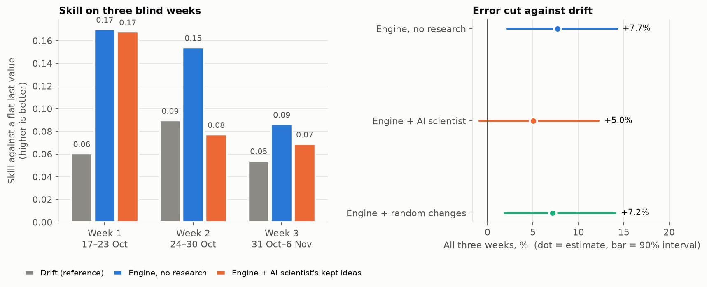
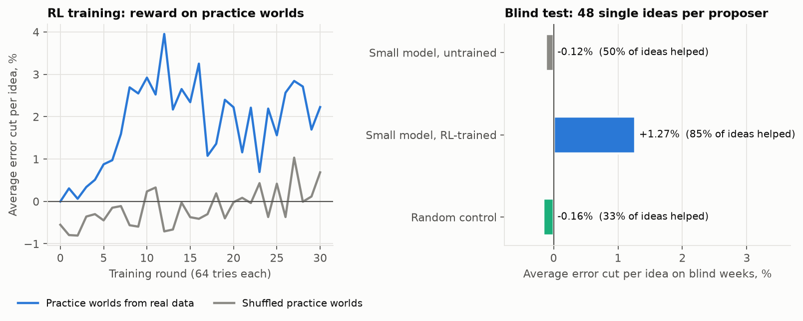
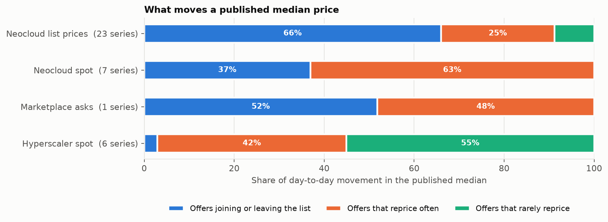

# Findings

**Direction A: self-improving GPU price forecasts.** Team entry for origin 6 November 2026, horizons 1, 3 and 7 days, 37 posted rental series.

## Summary

- **A forecast that looks inside the price list beats drift on weeks it had not seen.** Over three blind weeks (17 Oct–6 Nov, 1,196 forecasts) it cut error by 7.7% against drift, with a 90% interval of 2.2% to 14.3%. Its settings were fixed before any of that data was looked at.
- **An AI scientist did not improve it further.** A GPT-driven research loop proposed 32 hypotheses, kept 7, and its versions scored 2.9% worse than doing no research (interval −7.5% to +0.3%). In five shuffled copies of the data, where nothing about timing can be learned, the same loop changed error by −0.8% to +0.8%.
- **A small model trained with reinforcement learning found one change that held up.** Its ideas cut blind-week error by 1.3% on average and helped 85% of the time, against −0.1% for the same model untrained. As a full version that is +1.3% over the default (interval −3.0% to +5.8%), so not established.
- **Most movement in a published median is not providers changing prices.** For neocloud list prices, 66% of day-to-day movement comes from offers joining or leaving the list, 25% from one or two offers that reprice almost daily, and 9% from everyone else.
- **We submit the default engine.** No tuned version passed our own bar for "better".

## The question

Each scored series is the daily median of one site's price list for one GPU. Can a forecast that knows what is on the list beat a forecast that only knows how the median moved? And can an AI scientist, given that forecast and a strict test, make it better on data it has not seen?

## Method

**The engine.** Drift, the reference forecast, replays how the median itself moved in the past. The engine replays what each individual offer did over past pairs of days (repriced, stayed, left the list, joined it), applies that to today's list and recomputes the median. It therefore knows which offer sits in the middle today and how far its neighbours allow the middle to move. Example: a three-offer list at $0.79, about $1.30 and $1.57 has a median that can never leave $0.79–$1.57, whatever the middle provider does.

**The AI scientist.** An OpenAI model (`gpt-6.1-sol`) reads a ledger of earlier ideas and a diagnostics table, states one hypothesis, and tests it by changing at most three of the engine's 15 dials. It cannot write code. An idea is kept only if it lowers total error and does not lower the per-series average on past data, and then passes a hidden check on the most recent week, for which it is told only pass or fail. A control arm makes random dial changes through the same gate.

**The RL arm.** A small open model (Qwen3-8B on Tinker) was trained for 1,984 tries on 16 practice worlds built from data up to 16 Oct. Reward was the fall in error on a week the prompt did not show.

## Evaluation

The test was written down and committed before it was run ([PROTOCOL.md](PROTOCOL.md), commit `354fc20`).

- **Time machine.** The scientist lived through October one week at a time (16, 23 and 30 Oct). At each step its process received only data up to that date, in its own Modal container. A separate examiner then scored each frozen version on the following week.
- **Shuffled worlds.** Five copies of the data in which each offer keeps its listing pattern and its set of price changes, but the order of the changes in time is shuffled. They ran alongside the real world.
- **Scoring.** Pinball loss exactly as `starter/scorer.py` computes it; `tests/parity.py` confirms identical numbers. Intervals resample series and target days 2,000 times.
- **What had been seen.** Only data up to 16 Oct, from which came one hint given to the scientist and labelled as human: most providers rarely reprice, and one or two drive the median.
- **Claim rule.** "Better" means the 90% interval excludes zero.

## Results

### 1. The engine against drift

| Real world, three blind weeks | Total skill | Per-series average | Error cut against drift | Truth inside range |
|---|---|---|---|---|
| Drift | +0.065 (−0.017 to +0.152) | −0.009 | | 73% |
| **Engine, no research** | **+0.137 (+0.073 to +0.226)** | **+0.288** | **+7.7% (+2.2% to +14.3%)** | 73% |
| Engine + AI scientist | +0.112 (+0.030 to +0.216) | +0.265 | +5.0% (−0.9% to +12.3%) | 76% |
| Engine + random changes | +0.132 (+0.061 to +0.232) | +0.292 | +7.2% (+1.8% to +14.1%) | 73% |

Skill is 1 − our error ÷ the error of a flat last-value forecast. The gain is concentrated at longer horizons and in two kinds of series:

| Engine against drift | Forecasts | Error cut |
|---|---|---|
| 1 day ahead | 660 | +2.4% (−3.6% to +9.3%) |
| 3 days ahead | 464 | +7.6% (+1.1% to +15.8%) |
| 7 days ahead | 72 | +20.7% (+10.6% to +43.3%) |
| Neocloud list prices (67% of the error at stake) | 669 | +7.3% (+3.3% to +13.6%) |
| Neocloud spot (5%) | 273 | +72.5% (+56.8% to +83.8%) |
| Hyperscaler spot (14%) | 234 | +4.2% (−6.0% to +17.3%) |
| Marketplace asks (14%, one series) | 20 | −8.0% (−21.5% to +0.9%) |

At one day ahead the engine is not distinguishable from drift.

### 2. The scientist's research did not carry to blind weeks

| Total skill by blind week | Drift | No research | After step 1 | After step 2 | After step 3 |
|---|---|---|---|---|---|
| 17–23 Oct | 0.060 | 0.170 | 0.168 | | |
| 24–30 Oct | 0.090 | 0.154 | 0.110 | 0.077 | |
| 31 Oct–6 Nov | 0.054 | 0.086 | 0.090 | 0.061 | 0.069 |

- **The engine's edge is about the list, not about timing.** In the five shuffled worlds it beat drift by 6.6% to 10.8%, the same size as in the real world.
- **The scientist found more in the real world, and it did not last.** It kept 7 of 32 ideas in the real world against 15 of 160 across the shuffled worlds. On blind weeks the real-world ideas cost 2.9%.
- **The kept ideas bought coverage, not accuracy.** Truth landed inside the range 76% of the time instead of 73%, but error rose.

### 3. What the system learned across iterations

| Iteration | What changed | Blind result |
|---|---|---|
| 0 | Drift | reference |
| 1 | Engine: replay each offer, recompute the median | 7.7% less error than drift |
| 2 | Rehearsal: switching a series to drift when the engine had done worse on it | lowered skill on 2 of 3 rehearsal weeks and on all 3 blind weeks; dropped |
| 3 | Scientist, 16 Oct: ranges for list prices twice as wide; small 7-day floors | no change in week 1, worse in week 2 |
| 4 | Scientist, 23 Oct: weight recent weeks more; carry the trend of daily repricers | worse in weeks 2 and 3 |
| 5 | Scientist, 30 Oct: ignore past departures from list-price lists | slightly better than step 2, still below no research |
| 6 | Scientist, 6 Nov: 8 ideas, none kept; its last entry proposed no change | not testable |
| 7 | RL-trained model: use 30 days of history instead of 60 | +1.3%, better in all three weeks, not established |

Ideas the gate rejected, with the evidence in the ledger (`runs/record/real_gpt/state.json`):

- **Other sites do not lead.** Pulling a series toward recent moves of the same GPU on other sites cut skill on past data from +0.235 to +0.190.
- **The engine's middle carries information.** Replacing it with the last value cut skill from +0.212 to +0.194.
- **More history does not help.** Looking back 90 or 120 days changed nothing.
- **Wider is not better.** Widening all 7-day ranges raised coverage and raised error.

### 4. Reinforcement learning

- **Training.** Average reward on practice worlds rose from −0.35% to about +1.3% in 31 rounds, for about $2 of Tinker credit. On fresh practice samples the untrained model scored −0.45% and the trained one +1.29%.
- **What it learned.** It settled on two answers: "use a 30-day lookback" and "change nothing". That is one robust setting plus restraint, not a research strategy. GPT never tried a shorter lookback.
- **Blind test, as fixed beforehand.** 48 single ideas per proposer across the three steps:

| Proposer | Average error cut | Ideas that helped | Ideas that hurt |
|---|---|---|---|
| Small model, untrained | −0.12% | 50% | 27% |
| Small model, RL-trained | +1.27% | 85% | 15% |
| Random control | −0.16% | 33% | 38% |

Scored afterwards as a full version (not in the protocol), the 30-day lookback gives total skill +0.148 against the default's +0.137.

### 5. What moves a published median

- **Typical list-price list:** 12 offers from 10 providers, of which one reprices often. The median offer never changed price in the sample.
- **Who reprices often:** Verda (in 27 of the 37 series), AWS spot, Scaleway, Runcrate, SF Compute and Spheron.
- **The median still moved on about a third of days.** Across all 37 series, 49% of that movement is list changes, 38% frequent repricers and 13% rare repricers.

### 6. Rolling the engine forward

Feeding each simulated day back in, truth stays inside the range 77% of the time at 1 day, 52% at 7 days and about 40% from two weeks to 90 days. The rolled-forward engine can be trusted for days, not months. Beyond 30 days only three series have enough history to test.

### 7. Rentals and resale in 2–3 years

Details and charts are in [longview/LONGVIEW.md](longview/LONGVIEW.md) and [longview/RESALE.md](longview/RESALE.md).

**Rentals (AWS spot, USD per GPU-hour, median across zones; a different instrument from the 37 series).**

| | Now (31 Oct 2026) | +1 year | +2 years | +3 years |
|---|---|---|---|---|
| H100 | 3.86 | 2.69 (1.05–8.25) | 2.56 (0.97–7.15) | 2.54 (0.94–6.89) |
| A100 | 2.12 | 1.27 (0.78–3.18) | 1.25 (0.75–2.80) | 1.24 (0.74–2.70) |

- **The central path assumes the 2026 rise fades.** H100 spot rose from $2.13 to $3.86 between July and October 2026. If it does not fade, the middle is about $3.6 for the H100 and $2.0 for the A100.
- **Older chips did not fall faster when a successor arrived.** The A100 fell 20% a year before the H100 arrived and was flat afterwards. Adding a "new chip" effect to the simulation did not improve its test.
- **Tested horizon.** The method is supported to about six months. One year rests on 2–4 independent windows and three years is untested.

**Resale.** RESALE_PLACEHOLDER

## What someone pricing a lease or a loan could use

- **Read a published median with its list.** A move in a neocloud list-price median is far more likely to be a provider entering or leaving the sample, or one dynamic pricer, than a change in what providers charge.
- **Watch the frequent repricers separately.** A handful of providers carry the only day-to-day demand signal in these lists.
- **Do not extrapolate short-run engines.** Ranges that are right for a week are too narrow by a month.
- **Tuning on ten weeks of data overfits.** A careful gate, a hidden check and a strong model still produced changes that did not survive three blind weeks.

## The forecast we submit

`submission/forecast_2026-11-06.csv`: the engine at default settings (`versions/final.json`), 111 forecasts. It has the cleanest record: fixed before any data after 16 Oct was seen, and no later version was established as better. Two alternates are in `submission/` for comparison: the scientist's final version and the RL model's 30-day lookback.

## Limits

- **Three blind weeks is little evidence.** Intervals are wide, and results at 7 days rest on 72 forecasts.
- **The 37 series were chosen with hindsight to 6 Nov** by the starter kit's rule; results describe that set.
- **Short histories.** 20 series have 60 days of data and 13 have 89.
- **One model, one run.** The scientist's ideas are not deterministic; a second run would propose different ones.
- **Posted prices, not transacted prices.**

## Deviations from the protocol

Listed in [PROTOCOL.md](PROTOCOL.md): the RL trial was lengthened and continued despite collapsing to one answer on its single practice world; the submission uses the default engine instead of the scientist's final version.

## Reproduce

`bash reproduce.sh` rebuilds the forecast file from the pack in about 15 seconds with no AI calls. `bash reproduce.sh --with-backtest` replays the recorded ideas and reproduces the blind-test table.
