# An AI scientist for GPU rental prices

Entry for "Recursive Self-Improvement by Pacific: An AI Scientist for GPU Value" (Direction A).
It forecasts 37 posted GPU rental prices 1, 3 and 7 days ahead, and tests which kinds of AI help
make those forecasts better on data the system has not seen.

<p align="center">
  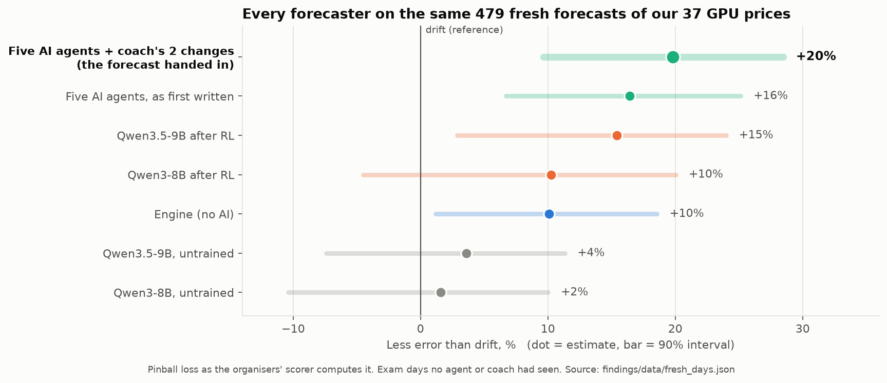
</p>

**The forecast we hand in is the average of five AI agents, after two changes that a coach AI proposed and tests kept.**
On days that neither the agents nor the coach had seen, it made 20% less error than drift, the reference forecast
(likely range 10% to 28%).

- **Findings:** [FINDINGS.md](FINDINGS.md)
- **Forecast file:** [submission/forecast_2026-11-06.csv](submission/forecast_2026-11-06.csv), the average of five AI agents
  after two changes that a coach AI proposed and tests kept.
  The engine alone is [submission/alt_engine_2026-11-06.csv](submission/alt_engine_2026-11-06.csv).
- **Test protocol, fixed before the test:** [PROTOCOL.md](PROTOCOL.md)
- **Explainer pages:** [how it works](docs/pages/build-walkthrough.html) · [the test periods](docs/pages/test-periods.html) · [the Exa lookups](docs/pages/exa-status.html)

## Contents

- [Main results](#main-results)
- [The same forecasts with other models](#the-same-forecasts-with-other-models)
- [How it works](#how-it-works)
- [Results in pictures](#results-in-pictures)
- [The forecast handed in](#the-forecast-handed-in)
- [Reproduce the forecasts](#reproduce-the-forecasts)
- [The pieces, file by file](#the-pieces-file-by-file)
- [Re-run the research](#re-run-the-research-needs-keys-in-env)
- [What is in `runs/`](#what-is-in-runs)
- [Rebuild the figures](#rebuild-the-figures)
- [Data and attribution](#data-and-attribution)

## Main results

| | Our 37 prices, 8 earlier weeks | Our 37 prices, 3 test weeks | AWS spot, 4 years |
|---|---|---|---|
| **Engine** (no AI) | +8.4% | +7.7% | +7.9% |
| **ML model** (Chronos-2) | −7.1% | +8.6% | +16.4% |
| **Five AI agents** | **+15.5%** | **+14.9%** | **+19.2%** |

<sub>Percent less error than drift. Likely ranges, sample sizes and caveats are in [FINDINGS.md §1](FINDINGS.md#1-three-separate-tests).</sub>

| What we tried to make the system improve itself | Held up on fresh days? |
|---|---|
| A **coach AI** rewrites the agent crowd (10 changes proposed, 2 kept) | ✅ a further 3% to 4% less error |
| **RL** teaches a small open model to forecast (practised on AWS only) | ✅ Qwen3-8B: 3% → 5–10%; Qwen3.5-9B: 5% → 9–11% |
| **RL inside a keep-or-roll-back loop** (Qwen3.5-9B: train 8 rounds, judge on a watch set, keep or roll back; 5 generations) | ✅ 1 kept, 4 rolled back; kept weights 5% → 8% on our prices (+4.0%, +0.1% to +6.8%) |
| An **AI scientist** tunes the engine's settings | ❌ slightly worse on unseen weeks |
| **RL** teaches a small model to propose engine settings | ❌ its one change is not clearly better |
| Agents **read each other's answers** | ❌ no help |
| **Memory** of the system's own past forecasts (three kinds) | ➖ 1.4% to 2.1% less error, not established |
| An **AI analyst** writes its own tests on shuffled data | ➖ found real weekday patterns; a rule built on them did not help |
| **One loop over the whole forecaster**: a vote that learns, range width, who votes (36 changes proposed) | ➖ kept nothing; none was clearly better on later days, one clearly worse. The one promising edit, tested on 20 fresh days: +0.9%, not established |

## The same forecasts with other models

Added 15 Nov. The five agents were built with one model, `gpt-6.1-sol`. We asked the same 479 fresh forecasts of five
other models: an untrained open model, and a cheaper and a dearer model from each of two makers. Nothing else changed:
the same facts, the same five jobs, the same averaging.

| Model answering | Five agents, as first written | With the coach's two changes | Ranges held | Cost of the run |
|---|---|---|---|---|
| Qwen3.5-9B, untrained (open model) | +6.4% | +11.6% | 61% → 70% | $0.65 |
| gpt-6-luna | +15.3% | +19.2% | 75% → 80% | $0.17 |
| **gpt-6.1-sol** (the crowd's own) | **+16.4%** | **+19.8%** | 74% → 80% | recorded earlier |
| gpt-6-astra | +16.6% | +20.7% | 74% → 80% | $12.01 |
| Claude Sonnet 5.5 | +19.3% | +18.9% | 82% → 87% | $5.77 |
| Claude Opus 5.5 | +22.0% | +22.7% | 80% → 86% | $11.45 |
| **Qwen3.5-9B after RL** (one prompt, no agents) | **+15.4%** | not run | 81% | about $16 to train |

<sub>Percent less error than drift on the same 479 forecasts (37 prices, 5 days). "Ranges held" is how often the truth fell inside the range, first written → with the coach's changes; the aim is 80%. Likely ranges and caveats are in [FINDINGS.md §11](FINDINGS.md#11-other-models-added-15-nov).</sub>

- **The result does not hang on one model.** Every API model cut error by 15% to 22%, including one whose whole run
  cost 17 cents. None is clearly better or worse than `gpt-6.1-sol`. Only the untrained open model fell clearly behind.
- **The coach's two changes carry over to the other GPT models and to the open model, but not to Claude.** They were
  chosen while working with `gpt-6.1-sol`. Claude's ranges already held about 80% of the time, so widening them added nothing.
- **RL puts the 9B open model level with the cheaper API models.** Qwen3.5-9B after RL, answering one prompt with no
  agents, cut error by 15% against drift on the same 479 forecasts (likely 3% to 24%). That is level with the three GPT
  models as first written (15% to 17%) and behind Claude Opus (22%; the gap is 8%, likely 0% to 16%). Untrained, the
  same model scored 4% with one prompt and 6% as five agents.

No rule was written before this ran, and each model was run once.

## How it works

<p align="center">
  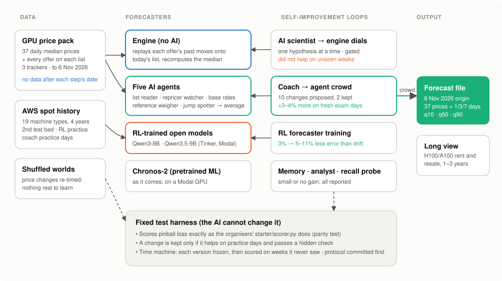
</p>

Each scored price is the **median of one site's list of offers** for one GPU. Drift, the reference forecast, only
replays how that median moved before. The engine looks underneath it: it replays what each *offer* did over
past pairs of days (repriced, stayed, left the list, rejoined), applies that to today's list and takes the median
again. The spread of those replayed medians gives the forecast range.

<p align="center">
  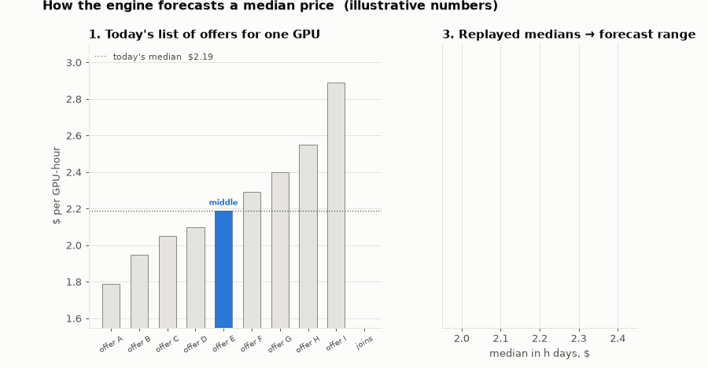
  <br><sub>The engine, step by step (illustrative numbers). <a href="docs/media/engine_replay.mp4">MP4 version</a> · code: <code>src/gpuval/engine.py</code></sub>
</p>

The explainer pages walk through the same ideas with real prices:

<table>
  <tr>
    <td width="50%" align="center"><a href="docs/pages/build-walkthrough.html">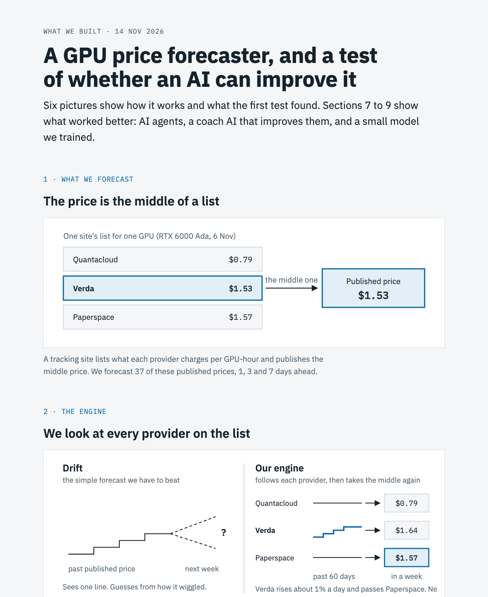</a><br><sub><b>How it works</b>: the price is the middle of a list; drift against the engine</sub></td>
    <td width="50%" align="center"><a href="docs/pages/test-periods.html">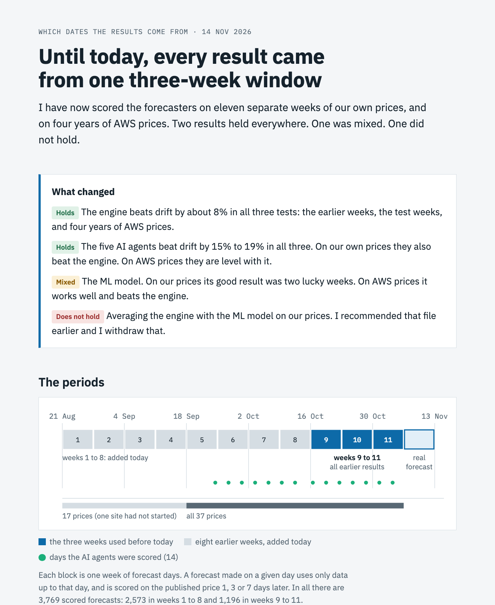</a><br><sub><b>The test periods</b>: eleven weeks of our prices and four years of AWS</sub></td>
  </tr>
</table>

<sub>GitHub shows `.html` files as source. To view a page, open it locally in a browser.</sub>

## Results in pictures

All figures are made by `uv run python -m gpuval.figures` from files already in `findings/data/`. Each one is
explained in [FINDINGS.md](FINDINGS.md).

### Three separate tests

The engine beats drift by about 8% everywhere. The five agents beat it by 15% to 19%. The ML model swings from −7% to +16%.

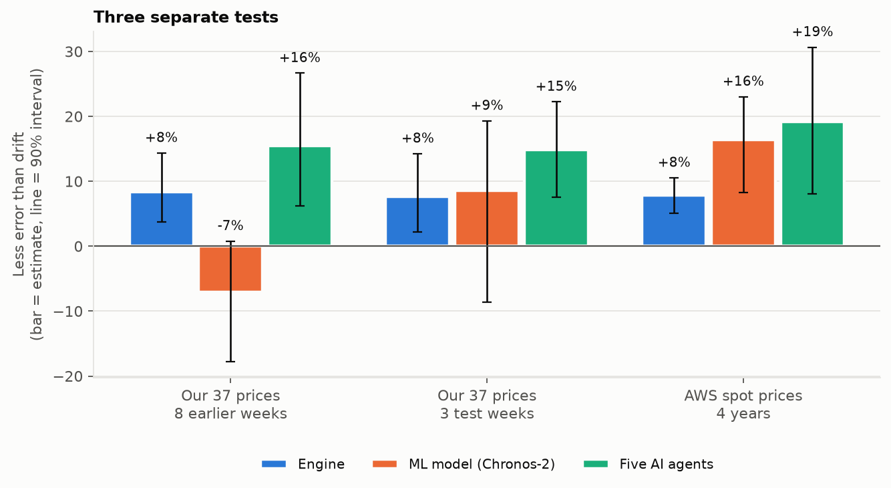

### Two improvement loops that held up

Left: the coach's two kept changes, scored on days it never saw. Right: RL training moves two open models from about level with drift to clearly ahead, on prices they never practised on.

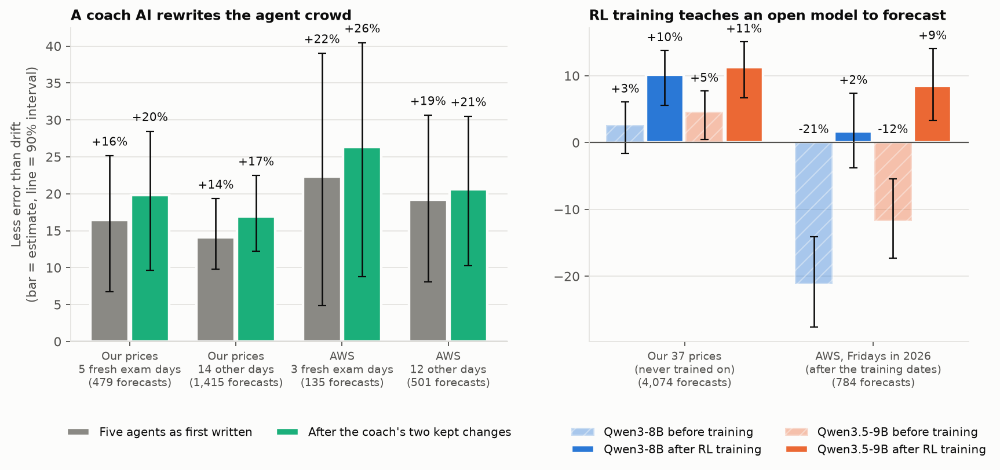

### What moves a published median

Most of the movement is offers joining or leaving the list, not providers changing their prices. That is the engine's reason for existing.

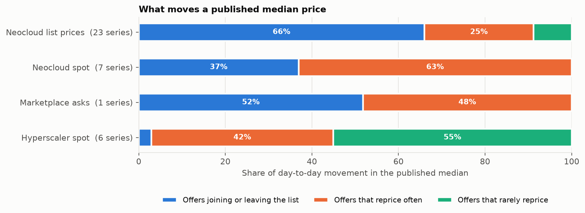

### Ranges hold far less often when the price moves

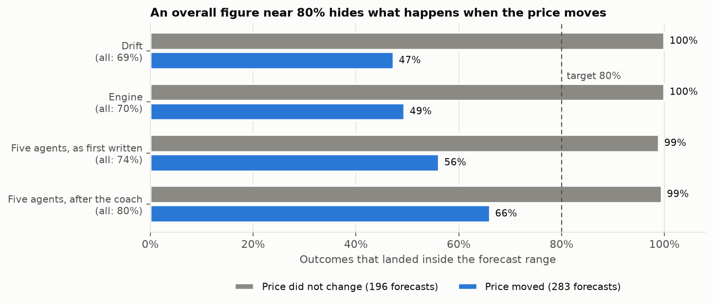

<details>
<summary><b>More figures</b>: blind weeks, shuffled worlds, RL runs, range memory, agent memory, the euro, the single loop (9 more)</summary>

#### The AI scientist on three blind weeks
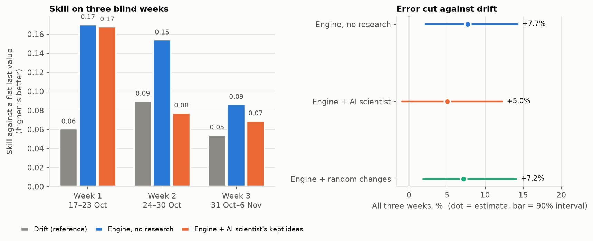

#### Real against shuffled worlds
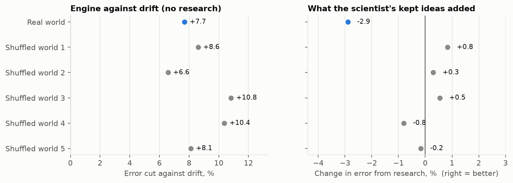

#### Rolling the engine forward: how far its ranges hold
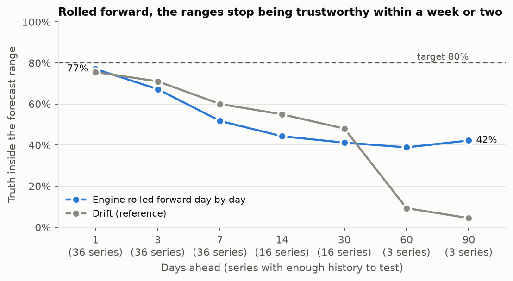

#### RL: proposing engine settings, and forecasting directly
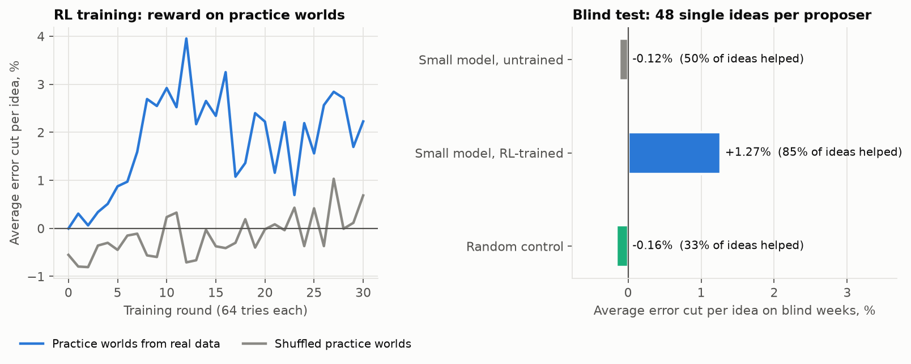

#### Every RL training run (Tinker and Modal, two seeds)
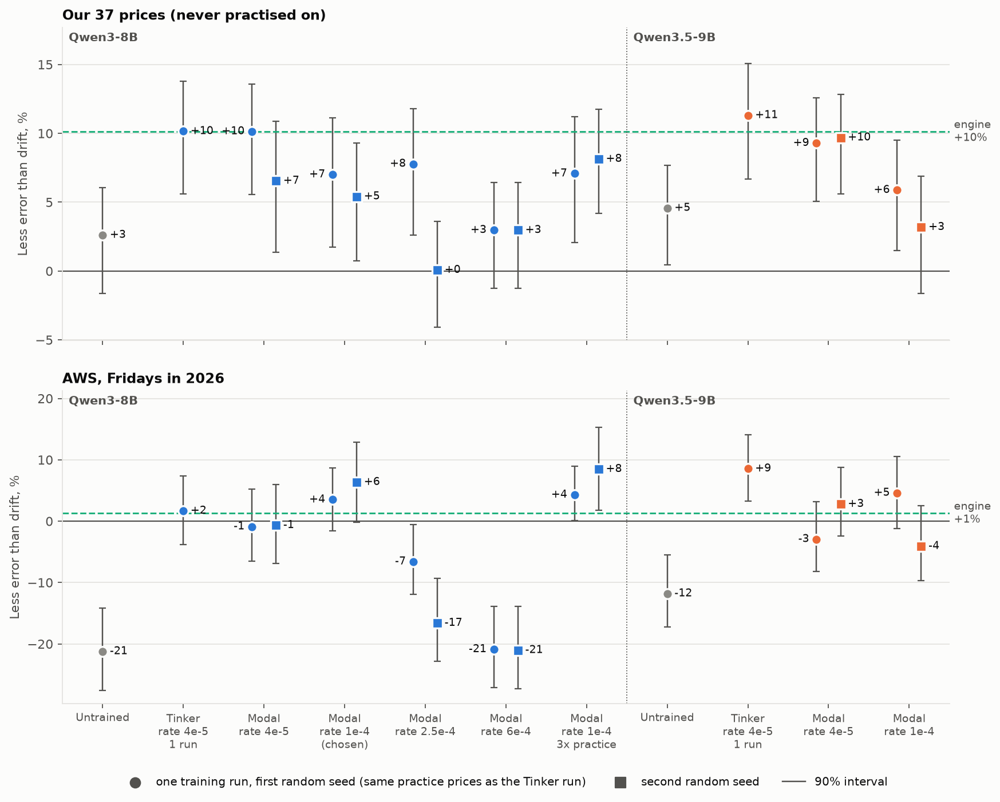

#### Range memory: no AI, ranges set from earlier forecasts whose outcomes are known
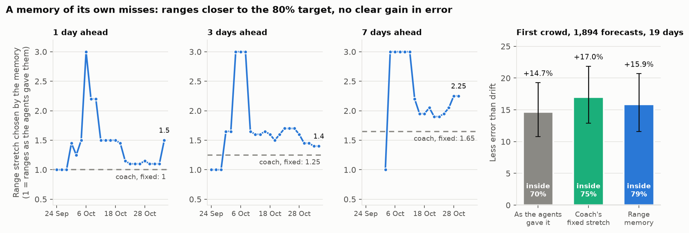

#### A scored price that follows the euro: moves Tuesday to Saturday only
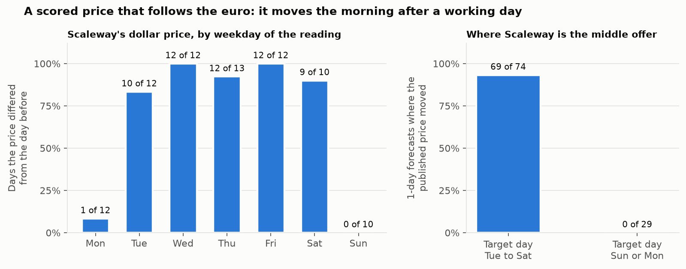

#### Agent memory: no memory, a scored record, a record plus a self-written lesson
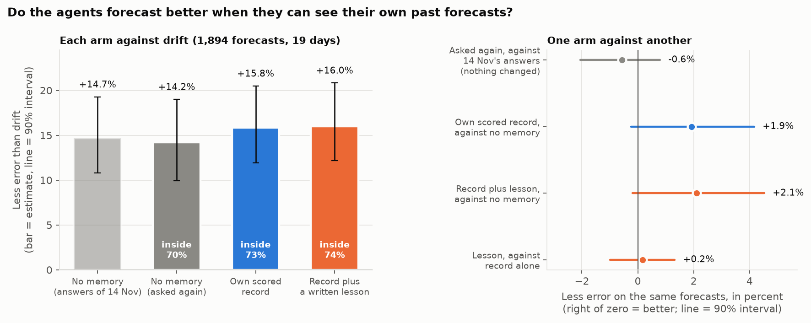

#### One loop over the whole forecaster: every edit it proposed, and what the edit did on later days
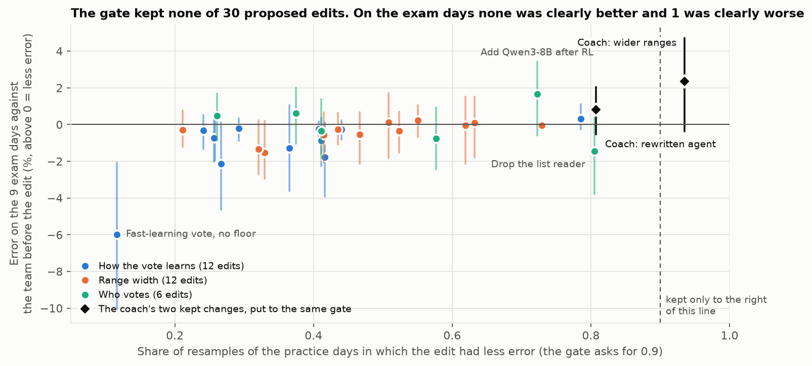

</details>

## The forecast handed in

From 6 November 2026: a low (10th percentile), middle and high (90th percentile) for each of the 37 prices at 1, 3 and 7 days.
Most list prices are expected to hold. The wide ranges are on the marketplace and spot prices, where offers come and go.

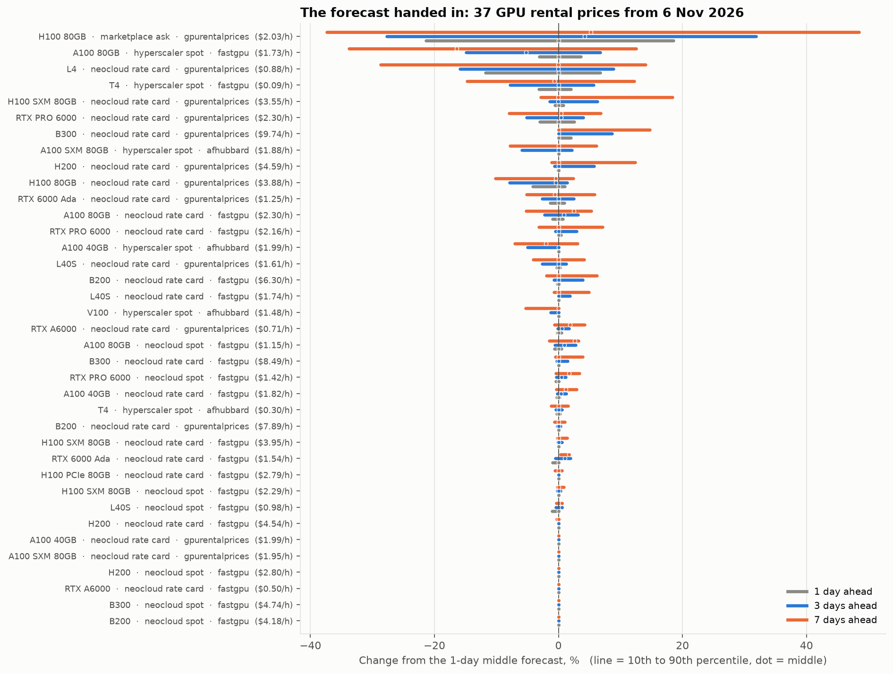

## Reproduce the forecasts

```bash
bash reproduce.sh                  # the forecast files, about 15 seconds; no AI calls, no Modal, no network
bash reproduce.sh --with-backtest  # also replays the recorded ideas through the blind test (about 4 minutes)
```

Needs [uv](https://docs.astral.sh/uv/) and the unchanged data pack in
`./gpu-price-pack-v0.1.1-handover` (or `GPUVAL_PACK=/path/to/pack`). The script checks that this
repo's scoring matches the organisers' `starter/scorer.py`, then writes the forecast files and prints
their SHA-256. The main file is rebuilt from the agents' recorded answers in
`runs/coach/final_answers.json` (the crowd before the coach's changes: `runs/agents/final_answers.json`).

## The pieces, file by file

| Piece | File | What it does |
|---|---|---|
| Engine | `src/gpuval/engine.py` | Each series is the median of a site's price list. The engine replays what every individual offer did over past pairs of days, applies that to today's list, and recomputes the median. |
| Test harness | `src/gpuval/harness.py`, `core.py` | Builds forecast cells, scores them exactly as the starter kit does. Fixed code; the AI cannot change it. |
| AI scientist | `src/gpuval/scientist.py` | An OpenAI model proposes one hypothesis at a time as a change to the engine's dials. A gate keeps an idea only if it helps on past data and passes a hidden check. A ledger records every idea and what it taught. |
| Time machine | `src/gpuval/timemachine.py` | The scientist lives through October one week at a time. A separate examiner scores each frozen version on the weeks after it. |
| Shuffled worlds | `src/gpuval/data.py` (`make_placebo`) | Copies of the data with the timing of price changes shuffled, so there is nothing about timing to learn. They show how much of any gain is real. |
| Modal | `src/gpuval/modal_app.py` | Every research step runs in its own container that is sent only data up to that step's date. Real and shuffled worlds run side by side. |
| RL, proposing ideas | `rl/train_scientist.py`, `blind_test.py` | A small open model is trained with reinforcement learning on Tinker to propose better engine settings, then tested blind. |
| RL, forecasting | `rl/forecast_env.py`, `train_forecaster.py`, `eval_forecaster.py` | Qwen3-8B and Qwen3.5-9B are trained on AWS prices to forecast directly (reward: less error than drift), then tested on our prices, which they never practised on. |
| RL on Modal | `rl/modal_forecaster.py` | The same training with our own sampling and policy-gradient code on Modal H100s. Each run is a container, so learning rates and random seeds run side by side; the rate is chosen on a watch set, and test prompts are sent without outcomes. |
| Five AI agents | `src/gpuval/agents.py` | Five agents with different jobs each read a price's list and forecast it directly. |
| Coach | `src/gpuval/coach.py` | A coach AI proposes one change at a time to the agent crowd. A change is kept only if it helps on practice days and passes a hidden check; fresh exam days decide whether the result is used. The improved crowd is the forecast we hand in. |
| ML model | `src/gpuval/ml_challenger.py` | Chronos-2, a pretrained time-series model, run as it comes on a Modal GPU for comparison. One agent (the one that weighs reference forecasts) is shown its numbers; `ml_challenger final` writes them for the forecast day. |
| More test periods | `src/gpuval/periods.py`, `aws_test.py` | The same forecasters on eleven weekly periods of our prices and on four years of AWS spot prices. |
| How much room there is | `src/gpuval/headroom.py` | What a perfect forecast, and the best settings chosen with hindsight, would have scored. |
| What moves a median | `src/gpuval/insight.py` | Splits each day's change in a median into list changes, frequent repricers and rare repricers; rolls the engine forward to see how far its ranges hold. |
| Range memory | `src/gpuval/range_memory.py` | A forecaster sets its own range width, day by day, from its earlier forecasts whose outcomes are known. No AI calls. Also the control for the RL result: untrained model plus memory against trained model. |
| Checks on our own claims | `src/gpuval/checks.py` | How often ranges hold when the price moved; how few prices and days carry the pooled figures; each agent alone; the AWS test before and after the model's knowledge ends; the price that follows the euro; the engine on every other price in the pack. No AI calls. |
| Agent memory | `src/gpuval/agent_memory.py` | The five agents lived through 19 days in order, in three arms: no memory, each agent's own scored record for the price, and the record plus a lesson it writes for itself. |
| Recall probe | `src/gpuval/recall_probe.py` | Asks the agents' model, with no data shown, what the AWS prices were on its test days. Days after its knowledge ends are the control. |
| Analyst | `src/gpuval/analyst.py` | An AI writes one analysis function per idea. It runs in a Modal container with no keys and no network, against 39 shuffled copies of the data, and a passed idea must pass again on newer data the analyst never sees. |
| Weekday rule | `src/gpuval/weekday_rule.py` | Tests whether the weekday pattern the analyst found makes 1-day forecasts better. No AI calls. It does not. |
| RL inside a loop | `rl/rsi_forecaster.py` | Generation after generation: train Qwen3.5-9B for 8 rounds from the kept weights, score the new weights on a watch set of later AWS dates, keep them only if they are better in 90% of resamples, otherwise roll back and change the learning rate. The kept weights are then tested once on our prices. |
| One loop | `src/gpuval/rsi.py` | One self-improvement loop that runs unattended over the whole forecaster: a vote that learns each member's weight from its record, a paired accept test, one kind of change per generation, and an exam that takes each kept change out again. It starts from the forecast we handed in and can leave it only through the gate. |
| AI calls with a meter | `src/gpuval/llm.py` | One helper for the three modules above: cheaper flex tier first, token and cost totals, a budget that stops the run. |
| Other models | `runs/other_models/run_crowd.py`, `table.py` | `run_crowd.py` asks the five agents' questions of another model (OpenAI, Anthropic, or an open model on Tinker), with a spending limit. `table.py` scores every model on the same 479 forecasts. |
| Long view | `longview/` | AWS spot rent for H100 and A100 one to three years out (capped at AWS's list price, with hardware-trend paths beside it), and a resale view with a floor. |

## Re-run the research (needs keys in `.env`)

<details>
<summary>All research commands (OpenAI, Modal and Tinker keys as noted)</summary>

```bash
uv run python -m gpuval.timemachine --name record --modal \
    --steps 2026-10-16,2026-10-23,2026-10-30,2026-11-06     # OPENAI_API_KEY + Modal token
uv run python -m gpuval.report --name record                 # tables with 90% intervals
uv run python -m gpuval.insight                              # what moves the median; roll-forward test
uv run python -m gpuval.figures                              # figures in findings/figures/
uv run python -m gpuval.ml_challenger                        # pretrained model on a Modal GPU
uv run python -m gpuval.agents --origins 2026-10-16,2026-10-19,2026-10-22,2026-10-25,2026-10-28,2026-10-31,2026-11-03
uv run python -m gpuval.periods build && uv run python -m gpuval.periods agents && uv run python -m gpuval.periods table
uv run python -m gpuval.aws_test build && uv run python -m gpuval.aws_test agents && uv run python -m gpuval.aws_test table
uv run python longview/longview.py && uv run python longview/resale.py
uv run python -m gpuval.coach run --generations 10 && uv run python -m gpuval.coach exam   # the coach loop, then its exam
uv run python -m gpuval.coach confirm && uv run python -m gpuval.coach final                # second check; the 6 Nov forecast
cd rl && uv run python train_scientist.py --name full --rounds 31   # TINKER_API_KEY
cd rl && uv run python train_forecaster.py --name fc2 --rounds 60 --base-model Qwen/Qwen3.5-9B && uv run python eval_forecaster.py --name fc2
uv run python -m gpuval.coach compare                               # every forecaster on the same fresh days
uv run python -m gpuval.checks && uv run python -m gpuval.checks wide   # checks on the write-up's claims; no keys needed
uv run python -m gpuval.range_memory                                # range memory and the RL control; no keys needed
uv run python -m gpuval.ml_challenger final                         # the ML model's numbers for 6 Nov (Modal token)
uv run python -m gpuval.ml_challenger crossrun                      # the ML model with cross-learning and list covariates (Modal token)
uv run python -m gpuval.recall_probe run                            # about 210 AI calls; `table` re-scores saved answers
uv run python -m gpuval.agent_memory run                            # about 10,600 AI calls on the flex tier; `table` re-scores
uv run python -m gpuval.analyst run                                 # 12 AI calls and a sealed Modal container; `table` re-prints
uv run python -m gpuval.weekday_rule                                # the rule that follows from the analyst's finding; no keys needed
uv run python tests/longview_checks.py                              # the long view's ceiling and successor test; no pack needed
uv run python -m gpuval.rsi run                                     # the single loop: 12 AI calls at most; `--proposer random` is the control
uv run python -m gpuval.rsi run --proposer replay && uv run python -m gpuval.rsi exam   # recorded edits through the gate again, then the exam; no keys needed
uv run python tests/rsi_checks.py                                   # the loop's starting bundle is the handed-in forecast; no look-ahead in the vote
cd rl && uv run python rsi_forecaster.py --name rsi1 --base-model Qwen/Qwen3.5-9B && uv run python eval_forecaster.py --name rsi1 --base-from fc2   # RL inside the loop, then its test (TINKER_API_KEY)
uv run python -m gpuval.rsi fresh                                   # the follow-up on 20 fresh days, re-scored from saved answers; `fresh-ask` makes the 3,375 AI calls
cd rl && uv run modal deploy modal_forecaster.py && uv run python modal_forecaster.py launch --plan sweep1   # 8 training runs on Modal GPUs
cd rl && uv run python modal_forecaster.py collect --plan sweep1 && uv run python modal_forecaster.py summarize
uv run python runs/other_models/run_crowd.py --env .env --dry                              # rebuilds the prompts and re-scores the recorded answers; nothing paid
uv run python runs/other_models/run_crowd.py --env .env --model claude-opus-5-5 --cap 15   # the five agents on another model; --cap is a spending limit in USD
                                                                                           # (needs `uv pip install anthropic`, or `tinker` for an open model)
uv run python runs/other_models/table.py                                                   # all six models on the same 479 forecasts; no AI calls
```

</details>

A fresh run of the scientist or the agents will not repeat the recorded answers word for word (the
model is not deterministic). Every answer is saved: `runs/record/` for the scientist,
`runs/agents/` for the agents and `runs/coach/` for the coach loop. `reproduce.sh --with-backtest` replays the scientist's recorded ideas
and reproduces the blind-test table exactly.

## What is in `runs/`

- `runs/record/`: the for-the-record run. One folder per world and arm with the ledger
  (`state.json`), the blind scores (`exam.csv`) and every blind cell (`cells.parquet`).
- `runs/rehearsal_*/`: rehearsals on early-October steps, data up to 16 Oct only.
- `runs/agents/`: every answer the five agents gave, in the tests and for the 6 Nov forecast.
- `runs/coach/`: the coach's ledger of ten proposed changes (`state.json`), every agent answer it
  caused (`answers.json`), the exam and second-check scores, and the improved crowd's 6 Nov answers.
- `runs/agent_memory/`, `runs/recall/`, `runs/analyst/`: every answer from the three tests added on 15 Nov
  (the analyst's ledger holds each idea's code and its numbers on the real and shuffled data).
- `runs/rsi/`: the single loop of 15 Nov. One folder per run (`main` is the AI proposer, `random_1` to `random_5` the control) with every
  proposed edit and the gate's numbers (`state.json`); `exam_cells.parquet` holds the exam-day forecasts, and `fresh_answers.json` every answer of the follow-up on 20 fresh days.
- `rl/runs/rsi1/`: the RL loop of 15 Nov. Every generation with its watch score and whether it was kept (`log.json`), and the kept weights' test answers.
- `rl/runs/fc1/`, `rl/runs/fc2/`: training logs and test answers of the two RL-trained forecasters.
- `rl/runs/modal/`: every Modal training run (log, test answers, scored cells); `findings/data/modal_rl.json` puts them next to the Tinker runs.
- `runs/other_models/`: the five agents on five other models. Each `<model>/` folder holds every answer and the run's
  spend; `cells.parquet` has every forecast's error for every model and `table.json` every comparison.
- `docs/pages/`: three explainer pages (how it works, the test periods, the Exa lookups).

## Rebuild the figures

```bash
uv run python -m gpuval.figures          # findings/figures/*.png
uv run python docs/media/make_media.py   # README visuals in docs/media/; reads only files in this repo
```

## Data and attribution

Pacific Machines (2026). gpu-price-pack v0.1.1-handover, data cutoff 6 November 2026. CC BY 4.0 on
the compilation. The pack is not redistributed here. Forecast targets and offer rows come from:

- Hubbard, A. (2026). GPU Price Tracker dataset. https://github.com/alex-hubbard/gpu_price_tracker (CC BY 4.0).
- GPU rental price data by gpurentalprices.com (https://gpurentalprices.com), licensed under CC BY 4.0.
- Data: FastGPU GPU cloud pricing dataset (https://fastgpu.co/dataset), CC BY 4.0.
- "AWS Spot Price History", Eric Pauley (University of Wisconsin-Madison), Zenodo, https://doi.org/10.5281/zenodo.14198917, CC BY 4.0. Used for the long view, as the second test bed (`aws_test.py`), as the coach's practice and check days, and as the RL forecaster's training prices. No AWS row is an input to a forecast of the 37 prices, but the coach's two kept changes, which are in the forecast we hand in, were chosen partly on AWS days.
- MLCommons MLPerf Inference and Training results repositories, Apache License 2.0, and Epoch AI,
  'Data on machine learning hardware', https://epoch.ai/data/machine-learning-hardware (long view only).

Scoring code mirrors the pack's starter kit (`starter/_common.py`, `baselines.py`, `scorer.py`).
